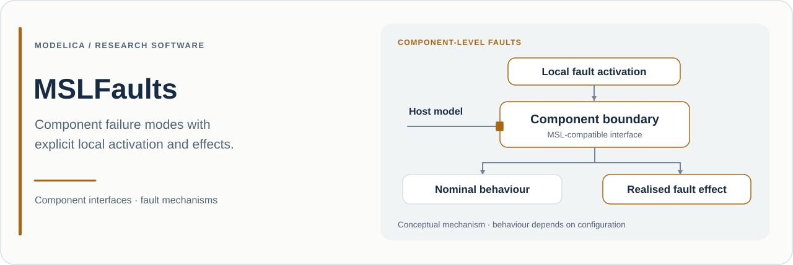

# MSLFaults

**Fault effects within Modelica components, with explicit links to their nominal MSL counterparts.**

**English** · [简体中文](README_zh.md)

[](package.mo)
[](package.mo)

[Purpose](#purpose) · [Implementation](#how-it-works) · [Quick start](#quick-start) · [Examples](#examples) · [Research use](#research-use)

## Purpose

MSLFaults supports the study of how component degradation and failure affect the behaviour of a physical system. It provides faultable components associated with named **Modelica Standard Library (MSL) 4.0.0 counterparts**, covering signal processing, electrical circuits, mechanics, heat transfer, fluid systems and magnetic circuits.

The research task is to replace a selected nominal component, configure a fault mechanism, and compare the resulting response with a controlled baseline. The fault is represented inside the component's constitutive behaviour: resistance can change, a sensor can acquire a bias, a valve can lose actuation authority, or an energy-storage parameter can deteriorate. The surrounding system continues to exchange physical quantities through Modelica connectors.

This makes the library useful for component-level fault-effect studies, diagnostic experiment design, sensitivity to degradation, and teaching the relationship between local failure mechanisms and system responses.

## At a glance

| Item | Current source |
| :--- | :--- |
| Modelica package | `MSLFaults` |
| Declared version | **0.6.0**, in [package.mo](package.mo) |
| External Modelica dependency | **Modelica 4.0.0** |
| Starting example | [Examples.ResistorReplacement](Examples/ResistorReplacement.mo) |
| Included experiments | **10** models in [Examples](Examples) |
| Component inventory | [model-catalog.csv](model-catalog.csv), including counterpart and recorded coverage fields |
| Version history | [CHANGELOG.md](CHANGELOG.md) |
| Reviewed source baseline | [`f6a7ea4`](https://github.com/Ruizhe-Yang/MSLFaults/commit/f6a7ea42237b540a61a8392899ea1695b3005111), 12 November 2026 |

The version above is the package's source annotation; identify a reproducible snapshot with its Git commit as well.

## How it works

### A named nominal reference and an explicit fault law

For example, [FaultableResistor](Electrical/Analog/Basic/FaultableResistor.mo) exposes the electrical pins and temperature-dependent resistance relation of a resistor, alongside modes for resistance drift, a resistance step, finite open/short approximations and temperature-coefficient drift. `Normal` selects the nominal behaviour. The accompanying example compares a native component, a normal faultable component and a faulted component under common excitation.

Replacement compatibility is a property of the selected class and host model. Inspect its connectors, parameters, initial conditions and nominal counterpart before integrating it; the inventory is a navigation aid, not a claim that every MSL component is covered.

### Activation is separate from the realised effect

Faultable components expose controls such as `enabled`, `faultMode`, `severity`, `faultStartTime`, `faultEndTime` and `transitionTime`. The [activation implementation](Utilities/Internal/Activation.mo) uses a half-open time window, or an optional external trigger when `useExternalTrigger=true`.

- `active` reports the requested or latched activation state.
- `effectLevel` reports the severity-scaled effect envelope.
- `activationCount` records rising activations.

During a recovery ramp, `active` can already be false while `effectLevel` remains non-zero. Latching and drift behaviour depend on the chosen fault mode; a time-window end should therefore be interpreted together with the component equation and diagnostics.

### Physical storage remains visible

Selected storage components expose quantities needed to examine the consequences of varying physical parameters. [FaultableCapacitor](Electrical/Analog/Basic/FaultableCapacitor.mo), for instance, evolves stored charge and provides `storedEnergy`, `lossPower` and `parameterPower`. These outputs help distinguish dissipative losses from energy changes associated with a prescribed parameter variation.

## Package map

| Package | Research role |
| :--- | :--- |
| [Blocks](Blocks) | Faultable gain, first-order dynamics, delay and limiting |
| [Electrical](Electrical) | Analogue components, sources, sensors, ideal devices and semiconductors |
| [Mechanics](Mechanics) | Rotational and translational components and sensors |
| [Thermal](Thermal) | Heat-transfer and simplified thermal-fluid components |
| [Fluid](Fluid) | Pipes, pumps, valves and fluid sensors |
| [Magnetic](Magnetic) | Flux-tube components and magnetic sensing |
| [Utilities](Utilities) | Activation logic and internal example assemblies |
| [UsersGuide](UsersGuide) / [Examples](Examples) | In-tool guidance and executable experiment definitions |

## Quick start

Install a Modelica tool and make **MSL 4.0.0** available. Clone the repository into a directory named `MSLFaults`:

```sh
git clone https://github.com/Ruizhe-Yang/MSLFaults.git MSLFaults
cd MSLFaults
```

In a graphical tool, load `package.mo`, open `MSLFaults.Examples.ResistorReplacement`, and use the example's experiment annotation: **0–5 s**, output interval **0.01 s**, tolerance **1e-6**.

For OpenModelica, the following can be saved as `quickstart.mos` in the repository root and run with `omc quickstart.mos`:

```modelica
loadModel(Modelica, {"4.0.0"});
loadFile("package.mo");
checkModel(MSLFaults.Examples.ResistorReplacement);
simulate(MSLFaults.Examples.ResistorReplacement,
  startTime=0, stopTime=5, numberOfIntervals=500,
  tolerance=1e-6);
getErrorString();
```

Inspect `resistorNativeCurrent`, `resistorNormalCurrent`, `resistorFaultCurrent` and `resistorFault.device.effectLevel`. The [example circuit](Utilities/Internal/ResistorCircuit.mo) sets a 12 V supply and a nominal 10 Ω resistor; the fault target is 20 Ω. Thus the corresponding steady currents are **1.2 A and 0.6 A by Ohm's law**; the transition shape follows the activation ramp. These values are analytical expectations from the example parameters, not a reported run on your machine.

## Examples

All names below belong to `MSLFaults.Examples`. Open the linked model for its complete configuration and experiment settings.

| Example | Study and useful signals |
| :--- | :--- |
| [ResistorReplacement](Examples/ResistorReplacement.mo) | Reversible resistance/conductance changes; compare the native, normal and faulted current outputs |
| [CapacitorDegradation](Examples/CapacitorDegradation.mo) | RC charging with capacitance loss; `nativeValue`, `normalValue`, `faultedValue` |
| [InductorDegradation](Examples/InductorDegradation.mo) | RL current with inductance loss; the three `*Value` outputs |
| [MagneticReluctance](Examples/MagneticReluctance.mo) | Flux response to increased reluctance; the three `*Value` outputs |
| [RotationalDamping](Examples/RotationalDamping.mo) | Separate damping, inertia and stiffness effects; speed and spring-torque outputs |
| [TranslationalStiffness](Examples/TranslationalStiffness.mo) | Stiffness, mass and damping changes; the five position outputs |
| [ThermalDegradation](Examples/ThermalDegradation.mo) | Thermal capacity, conduction and convection changes; temperature outputs |
| [FluidValveDegradation](Examples/FluidValveDegradation.mo) | Valve degradation and pressure-sensor bias; flow and pressure outputs; optional reverse-flow/frozen-command configurations |
| [SensorAndSignalFaults](Examples/SensorAndSignalFaults.mo) | Freeze, stuck output and bias; compare signal, voltage and current outputs |
| [ElectromechanicalFaultEffects](Examples/ElectromechanicalFaultEffects.mo) | Resistance/feedback configurations and magnetic turn loss; current, speed, temperature and flux outputs |

## Research use

Begin with a native-versus-normal comparison before activating a fault. Then vary one mechanism at a time, recording the target parameter, severity, onset, recovery, initial conditions and measured response. For storage elements, retain the energy diagnostics alongside the system-level quantities.

A reproducible report should identify the **repository URL, source version, commit, fully qualified experiment model, parameter modifications, tool version, MSL version, solver, tolerance and output interval**. Cite the software snapshot actually used. The catalogue records coverage per class and mode; it should not be read as a blanket statement that every fault mode has been simulated or every graphical view inspected.

### Scope and assumptions

- Fault effects are deterministic, configured mechanisms. Failure rates and probabilistic reliability estimates require an additional analysis design.
- Finite open/short targets and prescribed parameter changes are modelling approximations whose magnitudes should be justified for the host system.
- The examples isolate selected mechanisms. They do not establish application-wide accuracy or complete coverage of all component failures.

## Development and licensing

For a reproducible issue or contribution, include a small Modelica model, the chosen fault mode, the expected nominal behaviour, tool/MSL versions and the relevant diagnostics. Keep behavioural changes distinguishable from graphical or documentation edits, and consult the [changelog](CHANGELOG.md) when upgrading.

See [LICENSE](LICENSE) for repository licensing and [NOTICE.md](NOTICE.md) for the retained MSL 4.0.0 BSD 3-Clause attribution.
