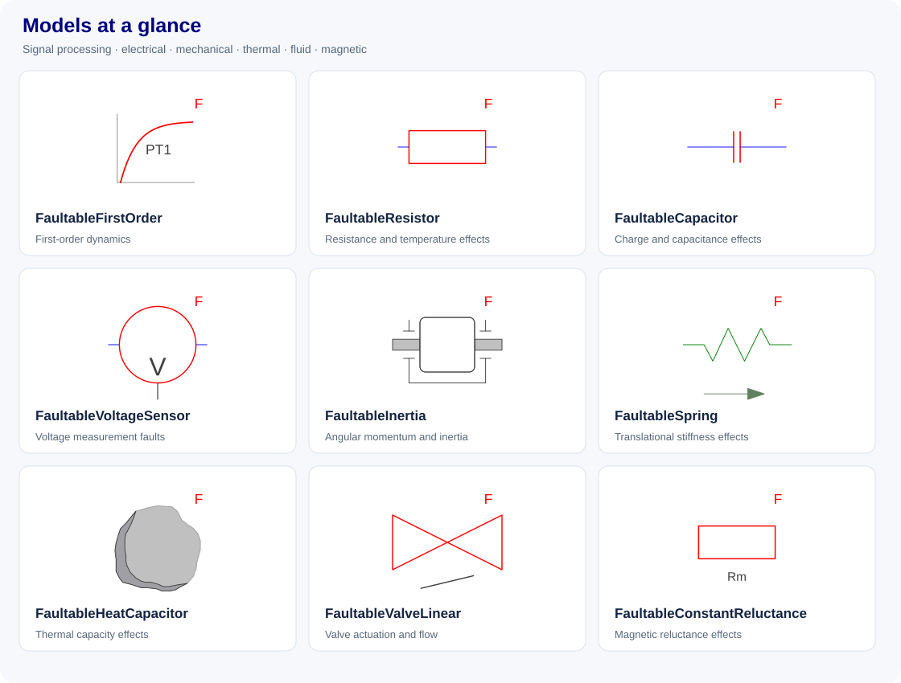

# MSLFaults v1.0.0

[English](README.md) · 简体中文

## 项目概述

MSLFaults 为 Modelica 信号与物理元件提供确定性故障模型，覆盖电气、机械、热、流体和磁领域，并支持局部故障模式、激活控制及响应诊断。

**依赖：**Modelica Standard Library 4.0.0。

## 使用手册

- [中文使用手册](docs/UserGuide.zh-CN.md)：安装、模型选型、配置练习与完整模型参考。
- [User Guide — English](docs/UserGuide.md)

## 许可证

[GNU General Public License v3](LICENSE) · [保留的第三方声明](NOTICE.md)
