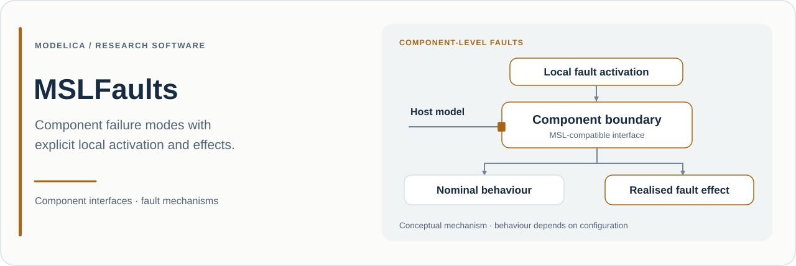

# MSLFaults

**在 Modelica 元件内部表达故障效应，并明确对应的 MSL 名义元件。**

[English](README.md) · **简体中文**

<!-- learning-guide:start -->
> **[详细学习与使用指南（中英双语 HTML）](docs/LearningGuide.html)** — 包含全部元件参考、接口与参数、逐例讲解和排错说明。下载单文件后用浏览器打开，可切换中文/英文并搜索元件。
<!-- learning-guide:end -->

[](package.mo)
[](package.mo)

## 项目目的

MSLFaults 用于研究元件退化与失效如何影响物理系统的行为。库中的故障元件具有明确的 **Modelica Standard Library（MSL）4.0.0 对应元件**，覆盖信号处理、电路、机械、传热、流体及磁路。

基本研究过程是：替换选定的名义元件，配置故障机理，再与受控基线比较响应。故障体现在元件本构行为中，例如电阻变化、传感器偏差、阀门执行能力下降或储能参数退化；外围系统仍通过 Modelica 连接器交换物理量。

本库适用于元件故障效应研究、诊断实验设计、退化敏感性分析，以及局部故障机理与系统响应关系的教学。

## 当前源码概况

| 项目 | 内容 |
| :--- | :--- |
| Modelica 包名 | `MSLFaults` |
| 声明版本 | **0.6.0**，见 [package.mo](package.mo) |
| 外部 Modelica 依赖 | **Modelica 4.0.0** |
| 推荐起点 | [Examples.ResistorReplacement](Examples/ResistorReplacement.mo) |
| 示例数量 | [Examples](Examples) 中的 **10** 个实验模型 |
| 元件索引 | [model-catalog.csv](model-catalog.csv)，含对应元件及已记录的覆盖信息 |
| 版本记录 | [CHANGELOG.md](CHANGELOG.md) |
| 说明核对基线 | [`f6a7ea4`](https://github.com/Ruizhe-Yang/MSLFaults/commit/f6a7ea42237b540a61a8392899ea1695b3005111)；核对日期 2026-11-12 |

上述版本取自源码包注解。复现实验时还应记录 Git 提交，以标识具体代码快照。

## 实现方式

### 明确的名义参照与故障方程

例如，[FaultableResistor](Electrical/Analog/Basic/FaultableResistor.mo) 保留电阻的电气引脚及温度相关电阻关系，并提供电阻漂移、阶跃变化、有限开路/短路近似和温度系数漂移等模式。`Normal` 表示名义行为。配套示例在相同激励下对比 MSL 原生元件、正常状态的故障元件与已激活故障的元件。

替换兼容性取决于具体元件和宿主模型。集成前应检查连接器、参数、初始条件及对应的名义元件；元件索引用于导航，并不意味着覆盖所有 MSL 元件。

### 激活状态与实际效应分别表达

故障元件提供 `enabled`、`faultMode`、`severity`、`faultStartTime`、`faultEndTime`、`transitionTime` 等控制项。[激活实现](Utilities/Internal/Activation.mo) 使用左闭右开的时间窗口，也可在 `useExternalTrigger=true` 时使用外部触发信号。

- `active`：请求激活或已锁存的激活状态。
- `effectLevel`：考虑严重度的实际效应包络。
- `activationCount`：激活上升沿次数。

恢复斜坡期间，`active` 可能已经变为 false，而 `effectLevel` 仍不为零。是否锁存以及如何漂移由具体故障模式决定，因此应结合元件方程与诊断量解释时间窗口结束后的行为。

### 保留物理储能信息

部分储能元件公开了分析时变物理参数所需的量。例如，[FaultableCapacitor](Electrical/Analog/Basic/FaultableCapacitor.mo) 以电荷演化为基础，并提供 `storedEnergy`、`lossPower`、`parameterPower`，便于区分耗散损失与外部规定的参数变化所带来的能量变化。

## 包结构

| 包 | 研究用途 |
| :--- | :--- |
| [Blocks](Blocks) | 含故障的增益、一阶环节、延时和限幅 |
| [Electrical](Electrical) | 模拟电路元件、电源、传感器、理想器件与半导体 |
| [Mechanics](Mechanics) | 转动和平动元件及传感器 |
| [Thermal](Thermal) | 传热及简化热流体元件 |
| [Fluid](Fluid) | 管道、泵、阀门与流体传感器 |
| [Magnetic](Magnetic) | 磁通管元件及磁量测量 |
| [Utilities](Utilities) | 激活逻辑与示例内部装配 |
| [UsersGuide](UsersGuide) / [Examples](Examples) | 建模工具内说明与可执行实验定义 |

## 快速开始

安装 Modelica 建模工具，并确保 **MSL 4.0.0** 可用。将仓库克隆到名为 `MSLFaults` 的目录：

```sh
git clone https://github.com/Ruizhe-Yang/MSLFaults.git MSLFaults
cd MSLFaults
```

在图形工具中加载 `package.mo`，打开 `MSLFaults.Examples.ResistorReplacement`，按模型注解设置 **0–5 s**、输出间隔 **0.01 s**、容差 **1e-6**。

使用 OpenModelica 时，可将以下内容保存为仓库根目录下的 `quickstart.mos`，再运行 `omc quickstart.mos`：

```modelica
loadModel(Modelica, {"4.0.0"});
loadFile("package.mo");
checkModel(MSLFaults.Examples.ResistorReplacement);
simulate(MSLFaults.Examples.ResistorReplacement,
  startTime=0, stopTime=5, numberOfIntervals=500,
  tolerance=1e-6);
getErrorString();
```

查看 `resistorNativeCurrent`、`resistorNormalCurrent`、`resistorFaultCurrent` 和 `resistorFault.device.effectLevel`。[示例电路](Utilities/Internal/ResistorCircuit.mo)设置了 12 V 电源和 10 Ω 名义电阻，故障目标为 20 Ω，依据欧姆定律，对应稳态电流应为 **1.2 A 和 0.6 A**；过渡形状由激活斜坡决定。这是根据示例参数得到的解析预期，并非在你的计算机上测得的仿真结果。

## 示例索引

以下模型均位于 `MSLFaults.Examples`。点击模型可查看完整配置及仿真设置。

| 示例 | 研究内容与建议观察量 |
| :--- | :--- |
| [ResistorReplacement](Examples/ResistorReplacement.mo) | 可恢复的电阻/电导变化；比较原生、正常与故障电流输出 |
| [CapacitorDegradation](Examples/CapacitorDegradation.mo) | 电容下降对 RC 充电的影响；`nativeValue`、`normalValue`、`faultedValue` |
| [InductorDegradation](Examples/InductorDegradation.mo) | 电感下降对 RL 电流的影响；三个 `*Value` 输出 |
| [MagneticReluctance](Examples/MagneticReluctance.mo) | 磁阻增加后的磁通响应；三个 `*Value` 输出 |
| [RotationalDamping](Examples/RotationalDamping.mo) | 分别改变阻尼、惯量及刚度；转速与弹簧力矩输出 |
| [TranslationalStiffness](Examples/TranslationalStiffness.mo) | 刚度、质量及阻尼变化；五组位置输出 |
| [ThermalDegradation](Examples/ThermalDegradation.mo) | 热容、导热及对流变化；温度输出 |
| [FluidValveDegradation](Examples/FluidValveDegradation.mo) | 阀门退化及压力测量偏差；流量和压力输出，可选反向流动/冻结指令配置 |
| [SensorAndSignalFaults](Examples/SensorAndSignalFaults.mo) | 冻结、固定输出与偏差；比较信号、电压及电流输出 |
| [ElectromechanicalFaultEffects](Examples/ElectromechanicalFaultEffects.mo) | 电阻/反馈配置与磁转换器匝数下降；电流、转速、温度及磁通输出 |

## 科研使用建议

先比较 MSL 原生元件与正常状态的故障元件，再激活故障。随后每次改变一个机理，记录目标参数、严重度、开始与恢复时刻、初始条件及测量响应。对于储能元件，应同时保留能量诊断量与系统级变量。

可复现的报告应记录**仓库 URL、源码版本、提交、完整实验模型名、参数修改、工具版本、MSL 版本、求解器、容差及输出间隔**，引用实际使用的软件快照。元件索引按类及模式记录覆盖情况，不能据此推断所有故障模式都已仿真或所有图形界面都经过人工检查。

### 范围与假设

- 故障效应是确定性配置的机理；失效率与概率可靠性估计需要另行设计分析过程。
- 有限开路/短路目标值和规定的参数变化属于模型近似，数值大小应依据宿主系统确定。
- 示例用于隔离和说明特定机理，不能代表应用级精度验证或所有元件故障的完整覆盖。

## 维护与许可

提交问题或贡献时，请附上小型 Modelica 复现模型、故障模式、预期名义行为、工具/MSL 版本及相关诊断量。区分行为变化、图形变化与文档变化，升级时查阅[版本记录](CHANGELOG.md)。

仓库许可见 [LICENSE](LICENSE)，MSL 4.0.0 的 BSD 3-Clause 上游声明见 [NOTICE.md](NOTICE.md)。
