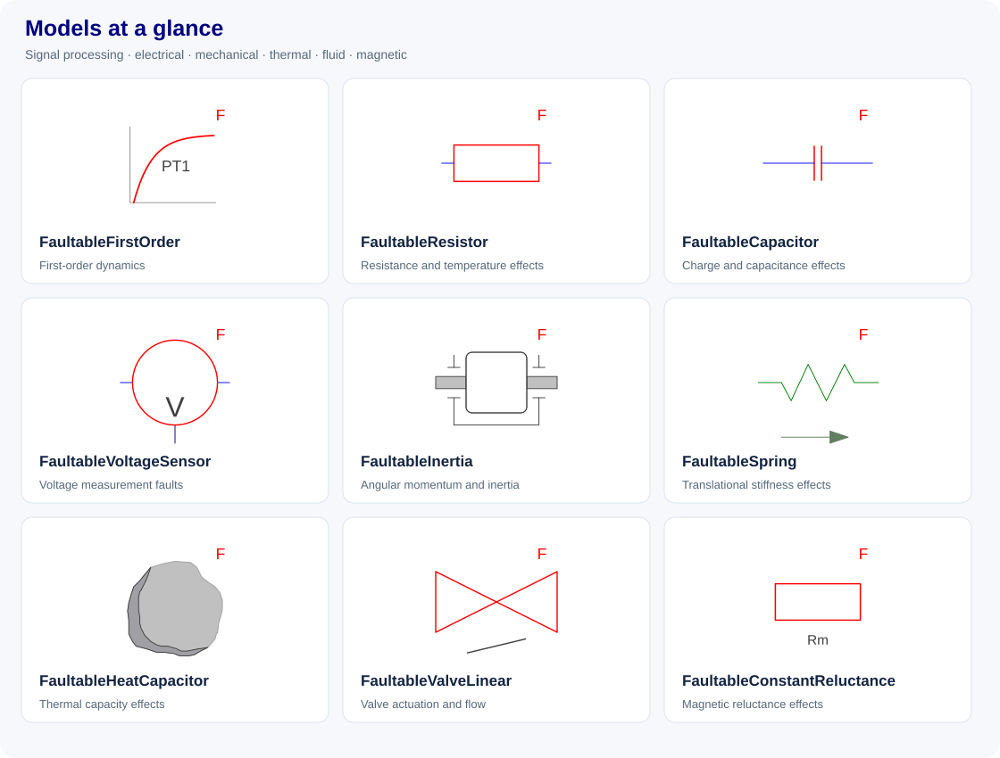

# MSLFaults v1.0.0 — User Guide

English · [简体中文](UserGuide.zh-CN.md)

## Contents

- [1. Scope and package structure](#1-scope-and-package-structure)
- [2. Load the library and run the first example](#2-load-the-library-and-run-the-first-example)
- [3. Establish the nominal configuration](#3-establish-the-nominal-configuration)
- [4. Configure activation and recovery](#4-configure-activation-and-recovery)
- [5. Build a first faulted circuit](#5-build-a-first-faulted-circuit)
- [6. Use an external trigger](#6-use-an-external-trigger)
- [7. Connect physical components and interpret diagnostics](#7-connect-physical-components-and-interpret-diagnostics)
- [8. Select modes and compare responses](#8-select-modes-and-compare-responses)
- [9. Complete model and class reference](#9-complete-model-and-class-reference)
- [10. Included examples](#10-included-examples)
- [11. Troubleshooting and modelling limits](#11-troubleshooting-and-modelling-limits)
- [12. Documentation and further reading](#12-documentation-and-further-reading)

## 1. Scope and package structure

MSLFaults provides **142 faultable components** associated with Modelica Standard Library 4.0.0 counterparts. They cover signal processing and electrical, mechanical, thermal, fluid and magnetic networks. The library contains **212 Modelica source files**, including packages, supporting models, in-tool guidance and **10 complete examples**. Its only library dependency is **Modelica Standard Library 4.0.0**.

Select a component by its nominal relation and connector interface, then configure a local `FaultMode`. The numerical target and implemented relation determine the effect. These are deterministic mechanism models: mode names and severity values do not establish failure rates or probabilities.

| Package | Faultable components | Contents |
| --- | --- | --- |
| [`Blocks`](../Blocks/package.mo) | 4 | Gain, first-order dynamics, delay and limiting. |
| [`Electrical`](../Electrical/package.mo) | 53 | Analogue components, sources, sensors, ideal devices and semiconductors. |
| [`Mechanics`](../Mechanics/package.mo) | 41 | Rotational and translational components and sensors. |
| [`Thermal`](../Thermal/package.mo) | 19 | Heat-transfer and simplified thermal-fluid components and sensors. |
| [`Fluid`](../Fluid/package.mo) | 15 | Pipes, pumps, valves and fluid sensors using Modelica.Fluid interfaces. |
| [`Magnetic`](../Magnetic/package.mo) | 10 | Flux-tube components, electromagnetic conversion and magnetic sensors. |

`Examples` contains complete comparison models. `Utilities.Internal` contains their assemblies and the shared activation block; `UsersGuide` provides concise guidance inside the modelling tool. `Electrical.Analog.Semiconductors.NPNFaultStage` is a supporting transistor circuit, separate from the 142 classes named `Faultable…`.



These previews use the existing local `Icon` graphics, including the red fault marker. Instance and parameter labels are omitted. Modelica tools also display inherited graphics and conditional connectors according to the component configuration.

## 2. Load the library and run the first example

1. Extract the archive and retain the complete `MSLFaults` directory.
2. Load Modelica 4.0.0 in the modelling environment, then open `MSLFaults/package.mo`.
3. Open `MSLFaults.Examples.ResistorReplacement` and inspect its Diagram view.
4. Use the stored experiment: 0–5 s, output interval 0.01 s and tolerance `1e-6`.
5. Plot `resistorNativeCurrent`, `resistorNormalCurrent`, `resistorFaultCurrent` and `resistorFault.device.effectLevel`. The equivalent conductor comparison is exposed by the three `conductor…Current` outputs.

Each resistor path has a 12 V supply and a nominal 10 Ω resistance. The faulted target is 20 Ω. The conductor paths use 0.1 S and a 0.05 S target. The following values are analytical expectations from these parameters, for comparison with the simulator output.

| Simulation instant | Native current | Normal-mode current | Faulted current |
| --- | --- | --- | --- |
| 0.5 s | 1.2 A | 1.2 A | 1.2 A |
| 2 s | 1.2 A | 1.2 A | 0.6 A |
| 4 s | 1.2 A | 1.2 A | 1.2 A |

The fault request is active during `[1,3)` s. A 0.05 s transition follows each edge. Inspect the resistance or conductance itself when interpreting the current shape: current varies reciprocally with resistance but linearly with conductance under a fixed voltage.

For OpenModelica, run the following from the directory containing the `MSLFaults` folder:

```modelica
loadModel(Modelica, {"4.0.0"});
loadFile("MSLFaults/package.mo");
checkModel(MSLFaults.Examples.ResistorReplacement);
simulate(MSLFaults.Examples.ResistorReplacement,
  startTime=0, stopTime=5, numberOfIntervals=500,
  tolerance=1e-6);
getErrorString();
```

## 3. Establish the nominal configuration

Use `faultMode=FaultMode.Normal` as the reference configuration, with the enumeration qualified by the selected class when necessary. Match the native component's nominal parameters, connector orientation, medium, initial conditions and optional ports. Compare the quantities needed by the surrounding system before selecting a fault.

For a graphical replacement, record the original component's class, instance name and modifiers, then replace it with the chosen `MSLFaults` component and reconnect the same physical or signal interface. Expose conditional ports only when the application uses them. A component can also be redeclared where the containing model supplies a compatible `replaceable` declaration and constraining class, as demonstrated by the included examples.

Compatibility is specific to the selected class and its configuration. Some components wrap a native model and modify a command or boundary relation; others implement their own constitutive equations. The model reference in section 9 records important restrictions, including inherited parameters that are not forwarded internally.

`enabled=false` and `severity=0` remove the activation request, but they are not a universal substitute for `Normal`: some sensor saturation equations apply their limits independently of the activation envelope. Use the mode law and the observed physical or signal result when assessing the reference case.

## 4. Configure activation and recovery

Most faultable components expose the following controls. Read their local declarations before editing a configuration.

| Setting or output | Meaning |
| --- | --- |
| `faultMode` | A class-specific enumeration. Use an identifier declared by the selected component. |
| `enabled` | Enables the selected fault request; it is normally true by default, while the default mode is `Normal`. |
| `severity` | Maximum activation-envelope level in `[0,1]`. Its physical interpretation follows the selected equation. |
| `faultStartTime`, `faultEndTime` | Internal half-open request window `[faultStartTime,faultEndTime)`. |
| `transitionTime` | Time for a full unit-level rise or fall. Zero gives an immediate envelope change. |
| `useExternalTrigger`, `trigger` | Expose and select the conditional Boolean trigger; it replaces the internal time window. |
| `active` | Requested or internally latched Boolean activation state. |
| `effectLevel` | Severity-scaled envelope used by the mode; it is not a universal measure of the realised physical fault. |
| `activationCount` | Number of activation starts, including an initially active request. |

The shared request requires `enabled=true`, a non-`Normal` mode and positive severity. With positive `transitionTime`, the envelope starts from zero and reverses continuously from its current level. During recovery, `active` may be false while `effectLevel` remains positive. A mode that requests permanent latching retains its activation; the individual model states whether it does so.

Many continuous targets use `nominal + effectLevel*(target-nominal)`. Some drift modes additionally use `driftTime`; other modes with the word `Drift` use only the activation envelope. Configure the actual target rather than inferring increase, loss or ageing from the mode name.

Several ideal switches, the ideal diode and Boolean fluid valves apply forced states only when `effectLevel>0.5`. For these modes, a maximum severity of 0.5 or less never crosses the override threshold. Their switching instant can therefore differ from the start of the request.

Captured output, a prescribed fixed output, a halted dynamic state and a permanent latch are distinct behaviours. For example, `Blocks.Continuous.FaultableFirstOrder` in `Stuck` mode suppresses state evolution at full effect, whereas its `Freeze` mode holds the captured output at full effect while the state continues to evolve. Use the component-specific definition when choosing recovery behaviour.

## 5. Build a first faulted circuit

Save the following model as `FirstResistorFault.mo`. Its `within;` clause places it at the top level; adapt that clause if it is stored inside a named working package.

```modelica
within;
model FirstResistorFault "Observe a reversible resistance change"
  Modelica.Electrical.Analog.Sources.ConstantVoltage supply(V=12);
  Modelica.Electrical.Analog.Basic.Ground ground;
  MSLFaults.Electrical.Analog.Basic.FaultableResistor resistor(
    R=10,
    faultMode=MSLFaults.Electrical.Analog.Basic.FaultableResistor.FaultMode.ResistanceStep,
    R_step=20,
    enabled=true,
    severity=1,
    faultStartTime=1,
    faultEndTime=3,
    transitionTime=0.05);
equation
  connect(supply.p, resistor.p);
  connect(resistor.n, ground.p);
  connect(supply.n, ground.p);
  annotation(experiment(StartTime=0, StopTime=5,
    Interval=0.01, Tolerance=1e-6));
end FirstResistorFault;
```

Run the model and plot `resistor.i`, `resistor.R_effective`, `resistor.active`, `resistor.effectLevel` and `resistor.activationCount`. Expect 1.2 A before activation, 0.6 A after the rise has completed and 1.2 A after recovery. To establish the nominal comparison, change only `faultMode` to the same class's `FaultMode.Normal` and rerun.

Then set `severity=0.5`. The full-plateau resistance becomes `10 + 0.5*(20-10) = 15 Ω`, so the plateau current is 0.8 A. This follows from interpolation of resistance; severity does not scale current directly. Set `transitionTime=0` only when an abrupt parameter change is appropriate for the connected system.

With `useHeatPort=true`, connect `heatPort` to a suitable thermal network and inspect the inherited `LossPower` output. With the default heat-port option disabled, the component uses its specified temperature condition internally.

## 6. Use an external trigger

The following signal example adds a bias when a Boolean condition is true. Enabling `useExternalTrigger` exposes the conditional `trigger` connector; the internal fault window is no longer used to select the request.

```modelica
within;
model FirstTriggeredGain "Apply a signal bias from a Boolean condition"
  Modelica.Blocks.Sources.RealExpression ramp(y=time);
  Modelica.Blocks.Sources.BooleanExpression condition(
    y=time >= 1 and time < 2);
  MSLFaults.Blocks.Math.FaultableGain gain(
    k=2,
    faultMode=MSLFaults.Blocks.Math.FaultableGain.FaultMode.Bias,
    biasFault=1,
    enabled=true,
    severity=0.5,
    transitionTime=0.1,
    useExternalTrigger=true);
equation
  connect(ramp.y, gain.u);
  connect(condition.y, gain.trigger);
  annotation(experiment(StartTime=0, StopTime=3,
    Interval=0.01, Tolerance=1e-6));
end FirstTriggeredGain;
```

Plot `ramp.y`, `condition.y`, `gain.y`, `gain.active` and `gain.effectLevel`. The normal gain output is `2*time`. The full-plateau bias is `severity*biasFault=0.5`, giving an expected output of 3.5 at 1.5 s. After the recovery ramp ends, the output returns to `2*time`. Replace the Boolean expression with the application condition while retaining the same connector.

Use a class-qualified enumeration in modifiers. `FaultableGain.FaultMode.Bias` and another class's identically named mode are separate enumeration types; a mode value must belong to the component being configured.

## 7. Connect physical components and interpret diagnostics

Physical connectors carry the network balances. Keep nominal orientation, references and boundary conditions when introducing a faultable component.

| Domain | Connection and observation |
| --- | --- |
| Electrical | Preserve pin orientation, electrical reference and any conditional heat port. Inspect voltage, current and the component's loss output. Finite open and short targets retain the topology. |
| Mechanics | Use the appropriate rotational or translational flanges, supports and initial conditions. Inspect effort, motion and effective parameters; locking torque or force may be a finite resistance rather than a rigid constraint. |
| Heat transfer | Connect meaningful temperature and heat-flow boundaries. Inspect the effective capacity or conductance together with the temperature response. |
| `Fluid` | Use a common compatible `Modelica.Media` medium, appropriate `inner Modelica.Fluid.System`, and the declared pressure, flow and stream conditions. |
| `Thermal.FluidHeatFlow` | Use its own simplified medium and connector family. Its ports are different from `Modelica.Fluid` ports. |
| Magnetic | Provide magnetic reference paths and inspect flux and magnetic potential difference. For electromagnetic conversion, inspect the electrical and magnetic quantities together. |

Storage-parameter changes require more than checking the final parameter value. The available diagnostics depend on the selected model.

| Component family | Interpretation |
| --- | --- |
| Faultable capacitor and inductor | Inspect stored charge or flux linkage, stored energy, loss and parameter-power terms where exposed. The implemented state relation determines the transient during a parameter change. |
| `FaultableMass`, `FaultableInertia` | Evolve linear or angular momentum with the effective mass or inertia. Their `parameterPower` accounts for the difference between stored-energy rate, port power and modelled loss. |
| Rotational and translational `FaultableSpring` | Stored energy uses the effective stiffness. A stiffness transition can change stored energy; inspect `parameterPower` as well as effort and deflection. |
| `FaultableHeatCapacitor` | Uses `storedEnergy=C_effective*T` with a fixed 0 K datum and `der(storedEnergy)=port.Q_flow`. Its `parameterPower` output is identically zero. |
| `FaultableMassWithStopAndFriction` | Uses effective mass times acceleration. At a hard stop, position and velocity are reset; the impact reset is not included in its continuous `lossPower`. |

Some names describe simplified surrogate effects. The heat capacitor's `ThermalRunaway` mode reduces capacity without adding a heat-generation term; its `SensorLag` changes physical capacity. The simplified thermal-fluid pipe's `Leakage` reduces pressure loss without extracting mass. Its heat-transfer-loss mode scales the medium-side contribution while leaving the external heat-port flow unchanged. These relations must suit the intended use.

## 8. Select modes and compare responses

Start with one mechanism and record its target, onset, severity and recovery settings. Keep stimulus, nominal parameters, initial conditions and solver settings consistent between runs. Compare the system response as well as `active` and `effectLevel`.

The following distinctions are particularly useful when choosing a model:

| Model or family | Implemented distinction |
| --- | --- |
| Mechanical and magnetic sensors | Saturation limits are applied whenever `faultMode=Saturation`, independently of the activation envelope. Their noise modes use a deterministic sinusoid. |
| Electrical current and voltage sensors | `Stuck` captures the measurement unless fixed-value operation is selected. Drift retains its accumulated offset during recovery, then removes it when the envelope reaches zero. |
| Electrical multi-sensor | Current, voltage and power measurements are modified separately; the reported faulted power need not equal the reported current multiplied by voltage. |
| Electrical waveform sources | Amplitude faults scale the whole waveform, including its offset. Frequency faults in sine/cosine sources modify the phase expression directly. |
| `Rotational.Components.FaultableIdealGear` | The extra `LockedGear` torque is proportional to a relative speed already constrained to zero by the ideal gear equation. It therefore adds no locking torque in this formulation. |
| Ideal electrical transformer | `PrimaryOpen` and `MagnetizationLoss` require `considerMagnetization=true` to affect the magnetising branch. |
| Unrestricted ideal operational amplifiers | Their input-leakage/short laws act across a differential input constrained to zero, giving no additional input current in those modes. |
| `Fluid.Machines.FaultablePump` | Several efficiency/friction labels prescribe extra shaft torque; they do not alter a hydraulic efficiency curve. Shaft seizure uses finite speed-proportional torque. |

The complete reference below adds the relevant settings and limits for each class. Measurement disturbances and physical faults can give different system responses even when their output plots look similar. Observe an independent physical quantity when the aim is to distinguish a measurement error from a change in the plant.

## 9. Complete model and class reference

The tables cover all 212 source files, grouped by package. Each link opens the corresponding Modelica definition. For faultable components, the nominal MSL counterpart, configuration and important limits are listed together; the local `FaultMode` enumeration and parameter dialogue provide the available selections. Nested helper classes are documented within their containing source file.

### 9.1. MSLFaults

| Class | Purpose and nominal reference | Configuration and limits |
| --- | --- | --- |
| [`MSLFaults`](../package.mo) | Component fault models for Modelica Standard Library interfaces | Load package.mo with Modelica 4.0.0 and begin with Examples.ResistorReplacement. |

### 9.2. Blocks

| Class | Purpose and nominal reference | Configuration and limits |
| --- | --- | --- |
| [`Blocks`](../Blocks/package.mo) | Faultable signal-processing blocks | Package overview and contents. |

### 9.3. Blocks.Continuous

| Class | Purpose and nominal reference | Configuration and limits |
| --- | --- | --- |
| [`Continuous`](../Blocks/Continuous/package.mo) | Continuous signal dynamics | Package overview and contents. |
| [`FaultableFirstOrder`](../Blocks/Continuous/FaultableFirstOrder.mo) | First-order response with parameter and output faults. Nominal: `Modelica.Blocks.Continuous.FirstOrder`. | Connect u and y, set k, T and initType, then choose the mode and its target. Stuck halts the state at full effect; Freeze blends the output towards the captured state. |

### 9.4. Blocks.Math

| Class | Purpose and nominal reference | Configuration and limits |
| --- | --- | --- |
| [`Math`](../Blocks/Math/package.mo) | Algebraic signal transformations | Package overview and contents. |
| [`FaultableGain`](../Blocks/Math/FaultableGain.mo) | Gain with drift, bias, capture and output limitations. Nominal: `Modelica.Blocks.Math.Gain`. | Set k and the selected mode target; connect u and read y. Use Freeze for captured output and Stuck for a prescribed value. |

### 9.5. Blocks.Nonlinear

| Class | Purpose and nominal reference | Configuration and limits |
| --- | --- | --- |
| [`Nonlinear`](../Blocks/Nonlinear/package.mo) | Delays and signal limits | Package overview and contents. |
| [`FaultableFixedDelay`](../Blocks/Nonlinear/FaultableFixedDelay.mo) | Causal signal delay with variable delay and output faults. Nominal: `Modelica.Blocks.Nonlinear.FixedDelay`. | Set nonnegative delayTime and delayTimeFault. All three delay-change modes share the same law; the target determines increase or decrease. |
| [`FaultableLimiter`](../Blocks/Nonlinear/FaultableLimiter.mo) | Signal limiter with bound changes and a fixed-output fault. Nominal: `Modelica.Blocks.Nonlinear.Limiter`. | Set ordered nominal and fault bounds, then connect u and y. Stuck blends towards stuckValue after limiting and may exceed those bounds. |

### 9.6. Electrical

| Class | Purpose and nominal reference | Configuration and limits |
| --- | --- | --- |
| [`Electrical`](../Electrical/package.mo) | Electrical components with configurable fault effects | Browse the component families in this package. |

### 9.7. Electrical.Analog

| Class | Purpose and nominal reference | Configuration and limits |
| --- | --- | --- |
| [`Analog`](../Electrical/Analog/package.mo) | Analogue electrical components and measurements | Browse the component families in this package. |

### 9.8. Electrical.Analog.Basic

| Class | Purpose and nominal reference | Configuration and limits |
| --- | --- | --- |
| [`Basic`](../Electrical/Analog/Basic/package.mo) | Passive and controlled electrical components | Browse the component families in this package. |
| [`FaultableCCC`](../Electrical/Analog/Basic/FaultableCCC.mo) | Current-controlled current source with gain faults. Nominal: `Modelica.Electrical.Analog.Basic.CCC`. | Connect both ports, set gain and gainFault, and inspect the effective transfer parameter and port output. The drift and StuckGain modes share the same reversible interpolation; StuckGain does not capture or latch a previous gain. |
| [`FaultableCCV`](../Electrical/Analog/Basic/FaultableCCV.mo) | Current-controlled voltage source with transresistance faults. Nominal: `Modelica.Electrical.Analog.Basic.CCV`. | Connect both ports, set transResistance and transResistanceFault, and inspect the effective transfer parameter and port output. The drift and StuckGain modes share the same reversible interpolation; StuckGain does not capture or latch a previous gain. |
| [`FaultableCapacitor`](../Electrical/Analog/Basic/FaultableCapacitor.mo) | Capacitor with variable capacitance, leakage and series loss. Nominal: `Modelica.Electrical.Analog.Basic.Capacitor`. | Set C and the selected target. Inspect v_cap, q, storedEnergy, lossPower and parameterPower when capacitance varies. parameterPower accounts for prescribed capacitance variation; it is distinct from dissipative loss. R_seriesNominal is a lower bound on fault targets, not a nominal series resistance. |
| [`FaultableConductor`](../Electrical/Analog/Basic/FaultableConductor.mo) | Conductor with conductance and temperature-coefficient faults. Nominal: `Modelica.Electrical.Analog.Basic.Conductor`. | Set G, G_fault or the finite open/short target; connect the electrical pins and optional heat port. Inspect G_actual and LossPower. ConductanceDrift and ConductanceStep use the same activation-envelope interpolation; neither has a separate drift clock. |
| [`FaultableGyrator`](../Electrical/Analog/Basic/FaultableGyrator.mo) | Gyrator with independent transfer-conductance faults. Nominal: `Modelica.Electrical.Analog.Basic.Gyrator`. | Connect the two electrical ports and choose G1_fault and G2_fault for the required coupling change. The two conductances are independently configurable; power balance depends on the chosen values. |
| [`FaultableInductor`](../Electrical/Analog/Basic/FaultableInductor.mo) | Inductor with inductance, winding-loss and turn-short faults. Nominal: `Modelica.Electrical.Analog.Basic.Inductor`. | Set L and the selected target; for TurnShort configure maxTurnShortRatio and R_turnShortLoss. Inspect psi, storedEnergy, lossPower and parameterPower. TurnShort is an equivalent winding model. parameterPower records the power associated with prescribed inductance variation. |
| [`FaultablePotentiometer`](../Electrical/Analog/Basic/FaultablePotentiometer.mo) | Potentiometer with track and wiper faults. Nominal: `Modelica.Electrical.Analog.Basic.Potentiometer`. | Connect pin_p, pin_n and contact; select useRinput for a commanded wiper and inspect r_effective, Rp, Rn and LossPower. ContactOpen is a finite resistance added to both track branches. WiperStuck uses a configured position rather than a captured position. |
| [`FaultableResistor`](../Electrical/Analog/Basic/FaultableResistor.mo) | Resistor with resistance and temperature-coefficient faults. Nominal: `Modelica.Electrical.Analog.Basic.Resistor`. | Set R and the selected resistance or alpha target; connect p and n and, when enabled, heatPort. Inspect R_effective, R_actual and LossPower. |
| [`FaultableTransformer`](../Electrical/Analog/Basic/FaultableTransformer.mo) | Coupled-inductor transformer with winding faults. Nominal: `Modelica.Electrical.Analog.Basic.Transformer`. | Set L1, L2 and M consistently, then configure the selected inductance target or R_open. Inspect winding currents and effective parameters. The equations multiply current derivatives by the varying inductances; they do not differentiate a time-varying flux-linkage matrix. |
| [`FaultableVCC`](../Electrical/Analog/Basic/FaultableVCC.mo) | Voltage-controlled current source with transconductance faults. Nominal: `Modelica.Electrical.Analog.Basic.VCC`. | Connect both ports, set transConductance and transConductanceFault, and inspect the effective transfer parameter and port output. The drift and StuckGain modes share the same reversible interpolation; StuckGain does not capture or latch a previous gain. |
| [`FaultableVCV`](../Electrical/Analog/Basic/FaultableVCV.mo) | Voltage-controlled voltage source with gain faults. Nominal: `Modelica.Electrical.Analog.Basic.VCV`. | Connect both ports, set gain and gainFault, and inspect the effective transfer parameter and port output. The drift and StuckGain modes share the same reversible interpolation; StuckGain does not capture or latch a previous gain. |
| [`FaultableVariableCapacitor`](../Electrical/Analog/Basic/FaultableVariableCapacitor.mo) | Variable capacitance with input faults. Nominal: `Modelica.Electrical.Analog.Basic.VariableCapacitor`. | Connect input C, set scaleFault, biasFault, stuckValue or lossValue, and check C_effective together with the lower bound Cmin. The declared input C must be nonnegative. StuckInput uses stuckValue and does not capture the input at activation. |
| [`FaultableVariableConductor`](../Electrical/Analog/Basic/FaultableVariableConductor.mo) | Variable conductance with input and finite open/short faults. Nominal: `Modelica.Electrical.Analog.Basic.VariableConductor`. | Connect input G and the electrical pins; set scaleFault, biasFault or the corresponding finite target. Inspect G_effective and G_actual. Choose targets that retain the intended passive behaviour and a positive temperature correction; the fault command is not clamped to a nonnegative value. |
| [`FaultableVariableInductor`](../Electrical/Analog/Basic/FaultableVariableInductor.mo) | Variable inductance with input faults. Nominal: `Modelica.Electrical.Analog.Basic.VariableInductor`. | Connect input L, set scaleFault, biasFault, stuckValue or lossValue, and check L_effective together with the lower bound Lmin. The declared input L must be nonnegative. StuckInput uses stuckValue and does not capture the input at activation. |
| [`FaultableVariableResistor`](../Electrical/Analog/Basic/FaultableVariableResistor.mo) | Variable resistance with input and finite open/short faults. Nominal: `Modelica.Electrical.Analog.Basic.VariableResistor`. | Connect input R and the electrical pins; set scaleFault, biasFault or the corresponding finite target. Inspect R_effective and R_actual. Choose targets that retain the intended passive behaviour and a positive temperature correction; the fault command is not clamped to a nonnegative value. |

### 9.9. Electrical.Analog.Ideal

| Class | Purpose and nominal reference | Configuration and limits |
| --- | --- | --- |
| [`Ideal`](../Electrical/Analog/Ideal/package.mo) | Ideal switching and amplification components | Browse the component families in this package. |
| [`FaultableControlledIdealClosingSwitch`](../Electrical/Analog/Ideal/FaultableControlledIdealClosingSwitch.mo) | Voltage-controlled closing switch with contact faults. Nominal: `Modelica.Electrical.Analog.Ideal.ControlledIdealClosingSwitch`. | Connect p, n and control; set RonFault or GoffFault for parametric faults and inspect off and LossPower. Forced switch positions require effectLevel>0.5; at severity<=0.5 they are never selected. Resistance and leakage changes follow the continuous envelope. |
| [`FaultableControlledIdealIntermediateSwitch`](../Electrical/Analog/Ideal/FaultableControlledIdealIntermediateSwitch.mo) | Voltage-controlled reversing switch with contact faults. Nominal: `Modelica.Electrical.Analog.Ideal.ControlledIdealIntermediateSwitch`. | Connect every switching terminal and the control input; inspect control_effective, Ron_effective, Goff_effective and LossPower. Forced switch positions require effectLevel>0.5; at severity<=0.5 they are never selected. Resistance and leakage changes follow the continuous envelope. |
| [`FaultableControlledIdealOpeningSwitch`](../Electrical/Analog/Ideal/FaultableControlledIdealOpeningSwitch.mo) | Voltage-controlled opening switch with contact faults. Nominal: `Modelica.Electrical.Analog.Ideal.ControlledIdealOpeningSwitch`. | Connect p, n and control; set RonFault or GoffFault for parametric faults and inspect off and LossPower. Forced switch positions require effectLevel>0.5; at severity<=0.5 they are never selected. Resistance and leakage changes follow the continuous envelope. |
| [`FaultableControlledIdealTwoWaySwitch`](../Electrical/Analog/Ideal/FaultableControlledIdealTwoWaySwitch.mo) | Voltage-controlled changeover switch with contact faults. Nominal: `Modelica.Electrical.Analog.Ideal.ControlledIdealTwoWaySwitch`. | Connect every switching terminal and the control input; inspect control_effective, Ron_effective, Goff_effective and LossPower. Forced switch positions require effectLevel>0.5; at severity<=0.5 they are never selected. Resistance and leakage changes follow the continuous envelope. |
| [`FaultableIdealClosingSwitch`](../Electrical/Analog/Ideal/FaultableIdealClosingSwitch.mo) | Boolean-controlled closing switch with contact faults. Nominal: `Modelica.Electrical.Analog.Ideal.IdealClosingSwitch`. | Connect p, n and control; set RonFault or GoffFault for parametric faults and inspect off and LossPower. Forced switch positions require effectLevel>0.5; at severity<=0.5 they are never selected. Resistance and leakage changes follow the continuous envelope. |
| [`FaultableIdealDiode`](../Electrical/Analog/Ideal/FaultableIdealDiode.mo) | Piecewise linear diode with conduction faults. Nominal: `Modelica.Electrical.Analog.Ideal.IdealDiode`. | Connect p and n, configure the finite targets, and inspect off, the effective parameters and LossPower. Forced on/off states require effectLevel>0.5. ShortCircuit retains the configured knee voltage, so its terminal relation is not generally a pure resistor. |
| [`FaultableIdealIntermediateSwitch`](../Electrical/Analog/Ideal/FaultableIdealIntermediateSwitch.mo) | Boolean-controlled reversing switch with contact faults. Nominal: `Modelica.Electrical.Analog.Ideal.IdealIntermediateSwitch`. | Connect every switching terminal and the control input; inspect control_effective, Ron_effective, Goff_effective and LossPower. Forced switch positions require effectLevel>0.5; at severity<=0.5 they are never selected. Resistance and leakage changes follow the continuous envelope. |
| [`FaultableIdealOpAmp`](../Electrical/Analog/Ideal/FaultableIdealOpAmp.mo) | Four-pin ideal operational amplifier with input faults. Nominal: `Modelica.Electrical.Analog.Ideal.IdealOpAmp`. | Connect an appropriate feedback network and set inputOffsetFault; inspect the differential input and the circuit response. In InputLeakage and InputShort the differential voltage is constrained to zero, so the added input current is also zero in this formulation. |
| [`FaultableIdealOpAmp3Pin`](../Electrical/Analog/Ideal/FaultableIdealOpAmp3Pin.mo) | Three-pin ideal operational amplifier with input faults. Nominal: `Modelica.Electrical.Analog.Ideal.IdealOpAmp3Pin`. | Connect an appropriate feedback network and set inputOffsetFault; inspect the differential input and the circuit response. In InputLeakage and InputShort the differential voltage is constrained to zero, so the added input current is also zero in this formulation. |
| [`FaultableIdealOpAmpLimited`](../Electrical/Analog/Ideal/FaultableIdealOpAmpLimited.mo) | Limited operational amplifier with offset, gain and output faults. Nominal: `Modelica.Electrical.Analog.Ideal.IdealOpAmpLimited`. | Connect differential inputs, output, both limit pins and a feedback circuit; inspect vin_effective, out_internal and out.v. gainFault is the inverse-slope parameter of the normalised characteristic; the dimensional small-signal output/input slope also depends on rail span. OutputStuck is applied after limiting and can lie outside the rails. |
| [`FaultableIdealOpeningSwitch`](../Electrical/Analog/Ideal/FaultableIdealOpeningSwitch.mo) | Boolean-controlled opening switch with contact faults. Nominal: `Modelica.Electrical.Analog.Ideal.IdealOpeningSwitch`. | Connect p, n and control; set RonFault or GoffFault for parametric faults and inspect off and LossPower. Forced switch positions require effectLevel>0.5; at severity<=0.5 they are never selected. Resistance and leakage changes follow the continuous envelope. |
| [`FaultableIdealTransformer`](../Electrical/Analog/Ideal/FaultableIdealTransformer.mo) | Ideal transformer with ratio and magnetising-path faults. Nominal: `Modelica.Electrical.Analog.Ideal.IdealTransformer`. | Set n and considerMagnetization, connect both windings, and configure nFault, Lm1Fault or R_open for the selected mode. MagnetizationLoss and PrimaryOpen affect the equations only when considerMagnetization=true. Keep the effective turns ratio nonzero. |
| [`FaultableIdealTwoWaySwitch`](../Electrical/Analog/Ideal/FaultableIdealTwoWaySwitch.mo) | Boolean-controlled changeover switch with contact faults. Nominal: `Modelica.Electrical.Analog.Ideal.IdealTwoWaySwitch`. | Connect every switching terminal and the control input; inspect control_effective, Ron_effective, Goff_effective and LossPower. Forced switch positions require effectLevel>0.5; at severity<=0.5 they are never selected. Resistance and leakage changes follow the continuous envelope. |

### 9.10. Electrical.Analog.Semiconductors

| Class | Purpose and nominal reference | Configuration and limits |
| --- | --- | --- |
| [`Semiconductors`](../Electrical/Analog/Semiconductors/package.mo) | Semiconductor devices with configurable degradation | Browse the component families in this package. |
| [`FaultableDiode`](../Electrical/Analog/Semiconductors/FaultableDiode.mo) | PN diode with junction and leakage faults. Nominal: `Modelica.Electrical.Analog.Semiconductors.Diode`. | Connect p and n; set the selected current, voltage-scale or resistance target. With temperature dependence enabled, connect heatPort and inspect LossPower. ForwardVoltageDrift changes the junction voltage scale rather than imposing a constant forward voltage. ShortCircuit retains the semiconductor branch. |
| [`FaultableNMOS`](../Electrical/Analog/Semiconductors/FaultableNMOS.mo) | N-channel MOS transistor with channel and leakage faults. Nominal: `Modelica.Electrical.Analog.Semiconductors.NMOS`. | Connect D, G, S and B, retain valid effective channel dimensions, and set the relevant target. Use the sign of stuckOnOverdrive appropriate to the channel polarity. StuckOn is an overdrive model, not a forced constant resistance. ShortCircuit retains the channel law; gate and bulk currents remain zero. |
| [`FaultableNPN`](../Electrical/Analog/Semiconductors/FaultableNPN.mo) | NPN transistor with gain, junction and collector-path faults. Nominal: `Modelica.Electrical.Analog.Semiconductors.NPN`. | Connect B, C and E and, when enabled, S and heatPort. Configure the selected gain, junction or RCEShort target and inspect terminal currents and LossPower. CollectorEmitterOpen attenuates collector transport; base-junction and substrate relations remain. It does not disconnect every terminal current. |
| [`FaultablePMOS`](../Electrical/Analog/Semiconductors/FaultablePMOS.mo) | P-channel MOS transistor with channel and leakage faults. Nominal: `Modelica.Electrical.Analog.Semiconductors.PMOS`. | Connect D, G, S and B, retain valid effective channel dimensions, and set the relevant target. Use the sign of stuckOnOverdrive appropriate to the channel polarity. StuckOn is an overdrive model, not a forced constant resistance. ShortCircuit retains the channel law; gate and bulk currents remain zero. |
| [`FaultableZDiode`](../Electrical/Analog/Semiconductors/FaultableZDiode.mo) | Zener diode with junction, breakdown and leakage faults. Nominal: `Modelica.Electrical.Analog.Semiconductors.ZDiode`. | Set Bv and the other nominal junction parameters, then configure BvFault, IdsFault, VtFault or the selected resistance target. The electrical law has no temperature dependence; the optional heat port exports dissipated power. The short-circuit mode retains both junction-current terms. |
| [`NPNFaultStage`](../Electrical/Analog/Semiconductors/NPNFaultStage.mo) | NPN stage with lead resistance and a shunt capacitance | Connect b, c and e as a circuit stage; set scenarioSeverity and faultMode and inspect Tr terminal currents. The transistor retains its default faultEndTime of 3 s. This assembly is not a direct replacement for a bare NPN transistor. |

### 9.11. Electrical.Analog.Sensors

| Class | Purpose and nominal reference | Configuration and limits |
| --- | --- | --- |
| [`Sensors`](../Electrical/Analog/Sensors/package.mo) | Electrical measurements with output faults | Browse the component families in this package. |
| [`FaultableCurrentSensor`](../Electrical/Analog/Sensors/FaultableCurrentSensor.mo) | Ideal current sensor with calibration, drift and hold faults. Nominal: `Modelica.Electrical.Analog.Sensors.CurrentSensor`. | Insert p and n in series; set the fault magnitude in A and compare i with i_actual. Drift uses severity times elapsed active time. During recovery its offset remains at the deactivation value until effectLevel reaches zero, then vanishes. |
| [`FaultableMultiSensor`](../Electrical/Analog/Sensors/FaultableMultiSensor.mo) | Current, voltage and power sensor with shared fault selection. Nominal: `Modelica.Electrical.Analog.Sensors.MultiSensor`. | Connect both measurement paths; configure biasCurrent/biasVoltage/biasPower or the corresponding stuck targets and inspect all three outputs. The faulted power output need not equal the product of the faulted current and voltage. noiseAmplitude and saturationLimit are shared numerical values interpreted in each channel unit. |
| [`FaultablePotentialSensor`](../Electrical/Analog/Sensors/FaultablePotentialSensor.mo) | Ideal potential sensor with output faults. Nominal: `Modelica.Electrical.Analog.Sensors.PotentialSensor`. | Connect p to the measured node and compare phi with phi_actual. Stuck uses the fixed stuckValue in V; it does not capture the current measurement. |
| [`FaultablePowerSensor`](../Electrical/Analog/Sensors/FaultablePowerSensor.mo) | Ideal power sensor with output faults. Nominal: `Modelica.Electrical.Analog.Sensors.PowerSensor`. | Insert pc/nc in the current path, connect pv/nv across the voltage of interest, and inspect power and power_actual. Stuck uses the fixed stuckValue in W; it does not capture the current measurement. |
| [`FaultableVoltageSensor`](../Electrical/Analog/Sensors/FaultableVoltageSensor.mo) | Ideal voltage sensor with calibration, drift and hold faults. Nominal: `Modelica.Electrical.Analog.Sensors.VoltageSensor`. | Connect p and n across the measured nodes; set the fault magnitude in V and compare v with v_actual. Drift uses severity times elapsed active time. During recovery its offset remains at the deactivation value until effectLevel reaches zero, then vanishes. |

### 9.12. Electrical.Analog.Sources

| Class | Purpose and nominal reference | Configuration and limits |
| --- | --- | --- |
| [`Sources`](../Electrical/Analog/Sources/package.mo) | Prescribed electrical sources with output faults | Browse the component families in this package. |
| [`FaultableConstantCurrent`](../Electrical/Analog/Sources/FaultableConstantCurrent.mo) | Constant current source with output faults. Nominal: `Modelica.Electrical.Analog.Sources.ConstantCurrent`. | Set the constant I. Connect p and n with the prescribed current sign convention and inspect effectiveOutput. AmplitudeDrift and AmplitudeDrop use the same scale interpolation, including any nominal offset. StuckOutput uses a fixed target. frequencyFault has no effect for this source. |
| [`FaultableConstantVoltage`](../Electrical/Analog/Sources/FaultableConstantVoltage.mo) | Constant voltage source with output faults. Nominal: `Modelica.Electrical.Analog.Sources.ConstantVoltage`. | Set the constant V. Connect p and n with the prescribed voltage sign convention and inspect effectiveOutput. AmplitudeDrift and AmplitudeDrop use the same scale interpolation, including any nominal offset. StuckOutput uses a fixed target. frequencyFault has no effect for this source. |
| [`FaultableCosineCurrent`](../Electrical/Analog/Sources/FaultableCosineCurrent.mo) | Cosinusoidal current source with output faults. Nominal: `Modelica.Electrical.Analog.Sources.CosineCurrent`. | Set I, f, phase, offset and startTime. Connect p and n with the prescribed current sign convention and inspect effectiveOutput. AmplitudeDrift and AmplitudeDrop use the same scale interpolation, including any nominal offset. StuckOutput uses a fixed target. FrequencyDrift scales the time-based phase expression directly; phase is not integrated from instantaneous frequency. |
| [`FaultableCosineVoltage`](../Electrical/Analog/Sources/FaultableCosineVoltage.mo) | Cosinusoidal voltage source with output faults. Nominal: `Modelica.Electrical.Analog.Sources.CosineVoltage`. | Set V, f, phase, offset and startTime. Connect p and n with the prescribed voltage sign convention and inspect effectiveOutput. AmplitudeDrift and AmplitudeDrop use the same scale interpolation, including any nominal offset. StuckOutput uses a fixed target. FrequencyDrift scales the time-based phase expression directly; phase is not integrated from instantaneous frequency. |
| [`FaultablePulseCurrent`](../Electrical/Analog/Sources/FaultablePulseCurrent.mo) | Pulse current source with output faults. Nominal: `Modelica.Electrical.Analog.Sources.PulseCurrent`. | Set I, width, period, offset and startTime. Connect p and n with the prescribed current sign convention and inspect effectiveOutput. AmplitudeDrift and AmplitudeDrop use the same scale interpolation, including any nominal offset. StuckOutput uses a fixed target. frequencyFault has no effect for this source. |
| [`FaultablePulseVoltage`](../Electrical/Analog/Sources/FaultablePulseVoltage.mo) | Pulse voltage source with output faults. Nominal: `Modelica.Electrical.Analog.Sources.PulseVoltage`. | Set V, width, period, offset and startTime. Connect p and n with the prescribed voltage sign convention and inspect effectiveOutput. AmplitudeDrift and AmplitudeDrop use the same scale interpolation, including any nominal offset. StuckOutput uses a fixed target. frequencyFault has no effect for this source. |
| [`FaultableRampCurrent`](../Electrical/Analog/Sources/FaultableRampCurrent.mo) | Ramp current source with output faults. Nominal: `Modelica.Electrical.Analog.Sources.RampCurrent`. | Set I, duration, offset and startTime. Connect p and n with the prescribed current sign convention and inspect effectiveOutput. AmplitudeDrift and AmplitudeDrop use the same scale interpolation, including any nominal offset. StuckOutput uses a fixed target. frequencyFault has no effect for this source. |
| [`FaultableRampVoltage`](../Electrical/Analog/Sources/FaultableRampVoltage.mo) | Ramp voltage source with output faults. Nominal: `Modelica.Electrical.Analog.Sources.RampVoltage`. | Set V, duration, offset and startTime. Connect p and n with the prescribed voltage sign convention and inspect effectiveOutput. AmplitudeDrift and AmplitudeDrop use the same scale interpolation, including any nominal offset. StuckOutput uses a fixed target. frequencyFault has no effect for this source. |
| [`FaultableSignalCurrent`](../Electrical/Analog/Sources/FaultableSignalCurrent.mo) | Signal-controlled current source with output faults. Nominal: `Modelica.Electrical.Analog.Sources.SignalCurrent`. | Connect the commanded current to input i. Connect p and n with the prescribed current sign convention and inspect effectiveOutput. AmplitudeDrift and AmplitudeDrop use the same scale interpolation, including any nominal offset. StuckOutput uses a fixed target. frequencyFault has no effect for this source. |
| [`FaultableSignalVoltage`](../Electrical/Analog/Sources/FaultableSignalVoltage.mo) | Signal-controlled voltage source with output faults. Nominal: `Modelica.Electrical.Analog.Sources.SignalVoltage`. | Connect the commanded voltage to input v. Connect p and n with the prescribed voltage sign convention and inspect effectiveOutput. AmplitudeDrift and AmplitudeDrop use the same scale interpolation, including any nominal offset. StuckOutput uses a fixed target. frequencyFault has no effect for this source. |
| [`FaultableSineCurrent`](../Electrical/Analog/Sources/FaultableSineCurrent.mo) | Sinusoidal current source with output faults. Nominal: `Modelica.Electrical.Analog.Sources.SineCurrent`. | Set I, f, phase, offset and startTime. Connect p and n with the prescribed current sign convention and inspect effectiveOutput. AmplitudeDrift and AmplitudeDrop use the same scale interpolation, including any nominal offset. StuckOutput uses a fixed target. FrequencyDrift scales the time-based phase expression directly; phase is not integrated from instantaneous frequency. |
| [`FaultableSineVoltage`](../Electrical/Analog/Sources/FaultableSineVoltage.mo) | Sinusoidal voltage source with output faults. Nominal: `Modelica.Electrical.Analog.Sources.SineVoltage`. | Set V, f, phase, offset and startTime. Connect p and n with the prescribed voltage sign convention and inspect effectiveOutput. AmplitudeDrift and AmplitudeDrop use the same scale interpolation, including any nominal offset. StuckOutput uses a fixed target. FrequencyDrift scales the time-based phase expression directly; phase is not integrated from instantaneous frequency. |
| [`FaultableStepCurrent`](../Electrical/Analog/Sources/FaultableStepCurrent.mo) | Step current source with output faults. Nominal: `Modelica.Electrical.Analog.Sources.StepCurrent`. | Set I, offset and startTime. Connect p and n with the prescribed current sign convention and inspect effectiveOutput. AmplitudeDrift and AmplitudeDrop use the same scale interpolation, including any nominal offset. StuckOutput uses a fixed target. frequencyFault has no effect for this source. |
| [`FaultableStepVoltage`](../Electrical/Analog/Sources/FaultableStepVoltage.mo) | Step voltage source with output faults. Nominal: `Modelica.Electrical.Analog.Sources.StepVoltage`. | Set V, offset and startTime. Connect p and n with the prescribed voltage sign convention and inspect effectiveOutput. AmplitudeDrift and AmplitudeDrop use the same scale interpolation, including any nominal offset. StuckOutput uses a fixed target. frequencyFault has no effect for this source. |
| [`FaultableSupplyVoltage`](../Electrical/Analog/Sources/FaultableSupplyVoltage.mo) | Dual-rail voltage supply with rail faults. Nominal: `Modelica.Electrical.Analog.Sources.SupplyVoltage`. | Connect pin_p, pin_n and ground, set Vps/Vns, and choose railScaleFault or groundShiftFault as required. GroundShift offsets both rails relative to the connected ground pin; it does not change the potential imposed on that ground pin by its network. |

### 9.13. Mechanics

| Class | Purpose and nominal reference | Configuration and limits |
| --- | --- | --- |
| [`Mechanics`](../Mechanics/package.mo) | Faultable mechanical components and sensors | Select a component by physical interface and fault law. |

### 9.14. Mechanics.Rotational

| Class | Purpose and nominal reference | Configuration and limits |
| --- | --- | --- |
| [`Rotational`](../Mechanics/Rotational/package.mo) | Rotational fault models and measurements | Select a component by physical interface and fault law. |

### 9.15. Mechanics.Rotational.Components

| Class | Purpose and nominal reference | Configuration and limits |
| --- | --- | --- |
| [`Components`](../Mechanics/Rotational/Components/package.mo) | Rotational components with configurable fault effects | Select a component by physical interface and fault law. |
| [`FaultableBearingFriction`](../Mechanics/Rotational/Components/FaultableBearingFriction.mo) | Bearing friction with configurable loss, wear and seizure effects. Nominal: `Modelica.Mechanics.Rotational.Components.BearingFriction`. | Connect the shaft flanges and optional support; set tau_pos and the selected friction scale, then inspect tau and lossPower. Wear follows the configured absolute times even with an external trigger. Its scale is retained while active or while effectLevel is positive, then returns to nominal; it is not a permanent wear state. |
| [`FaultableBrake`](../Mechanics/Rotational/Components/FaultableBrake.mo) | Rotational brake with separate static and sliding friction faults. Nominal: `Modelica.Mechanics.Rotational.Components.Brake`. | Supply f_normalized, set fn_max and mu_pos, and configure the relevant static or dynamic scale. A non-positive normal force releases the brake even in Sticking mode; an increased static threshold is a finite friction approximation. |
| [`FaultableClutch`](../Mechanics/Rotational/Components/FaultableClutch.mo) | Rotational clutch with separate static and sliding friction faults. Nominal: `Modelica.Mechanics.Rotational.Components.Clutch`. | Connect the two shafts, supply f_normalized and set fn_max, mu_pos and the selected friction scale. The clutch remains free for non-positive normal force. Inspect w_rel, tau and lossPower when distinguishing sliding from a locked friction state. |
| [`FaultableDamper`](../Mechanics/Rotational/Components/FaultableDamper.mo) | Rotational damper with bounded damping changes and progressive leakage. Nominal: `Modelica.Mechanics.Rotational.Components.Damper`. | Connect two rotational flanges and set dLoss, dIncrease, dLeak or dSeized for the selected mode. Leakage recovers with the effect envelope; Seizure is large finite damping rather than a rigid constraint. All effective damping must remain non-negative. |
| [`FaultableElastoBacklash`](../Mechanics/Rotational/Components/FaultableElastoBacklash.mo) | Rotational backlash with stiffness, damping and tooth-loss faults. Nominal: `Modelica.Mechanics.Rotational.Components.ElastoBacklash`. | Connect the shaft flanges; set c, d, total backlash b and the corresponding fault target. Inspect phi_rel and tau. The initial contact characteristic is regularised. ToothBroken remains active after the trigger or time window ends; full severity removes stiffness and damping. |
| [`FaultableElastoBacklash2`](../Mechanics/Rotational/Components/FaultableElastoBacklash2.mo) | Rotational backlash with stiffness, damping and tooth-loss faults and contact jumps. Nominal: `Modelica.Mechanics.Rotational.Components.ElastoBacklash2`. | Connect the shaft flanges; set c, d, total backlash b and the corresponding fault target. Inspect phi_rel and tau. The initial contact characteristic is regularised. ToothBroken remains active after the trigger or time window ends; full severity removes stiffness and damping. |
| [`FaultableGearbox`](../Mechanics/Rotational/Components/FaultableGearbox.mo) | Elastic gearbox with an additional fault torque. Nominal: `Modelica.Mechanics.Rotational.Components.Gearbox`. | Configure ratio, lossTable, c, d and b; connect the shafts and support, then select the added torque mode. The fault source does not change the native gear ratio or tooth stiffness. Its work is not included in the heat flow from the nominal gear and backlash components. |
| [`FaultableIdealGear`](../Mechanics/Rotational/Components/FaultableIdealGear.mo) | Ideal gear with a variable ratio and prescribed tooth torque. Nominal: `Modelica.Mechanics.Rotational.Components.IdealGear`. | Connect both shaft flanges and the optional support; configure ratioFault or toothTorque and toothFrequency. The ideal constraint makes the LockedGear residual identically zero, so this mode contributes no additional locking torque. A changing ratio is a prescribed kinematic intervention. |
| [`FaultableIdealPlanetary`](../Mechanics/Rotational/Components/FaultableIdealPlanetary.mo) | Planetary gear with ratio and additional torque faults. Nominal: `Modelica.Mechanics.Rotational.Components.IdealPlanetary`. | Connect sun, carrier and ring; set the nominal ratio and ratioFault or toothTorque, and inspect all three shaft torques. The additional torques do not impose a rigid shaft lock; the model contains no inertia or separate thermal dissipation port. |
| [`FaultableIdealRollingWheel`](../Mechanics/Rotational/Components/FaultableIdealRollingWheel.mo) | Ideal rolling wheel with radius and kinematic transmission faults. Nominal: `Modelica.Mechanics.Rotational.Components.IdealRollingWheel`. | Connect flangeR and flangeT with appropriate supports; set radiusFault or slipRatioFault and inspect both displacements. At full LockedWheel effect the translational displacement relative to support is zero. These modes alter ideal kinematics and do not describe tyre contact or a dissipative slip law. |
| [`FaultableInertia`](../Mechanics/Rotational/Components/FaultableInertia.mo) | Rotational inertia with momentum-based parameter variation. Nominal: `Modelica.Mechanics.Rotational.Components.Inertia`. | Set J and the initial shaft state; choose JFault or lockDamping and inspect momentum, storedEnergy, lossPower and parameterPower. Varying inertia requires positive endpoint values. Drift follows the activation envelope without a separate ageing clock. |
| [`FaultableLossyGear`](../Mechanics/Rotational/Components/FaultableLossyGear.mo) | Gear with nominal mesh losses and an additional fault torque. Nominal: `Modelica.Mechanics.Rotational.Components.LossyGear`. | Set ratio and lossTable, then select ratioFault, lossTorqueFault or lockDamping; inspect addedLossTorque separately from lossPower. lossPower contains only tauLoss*w_a, so additional fault-torque work is not included in that output or its heat port. Keep wRegularization positive. |
| [`FaultableOneWayClutch`](../Mechanics/Rotational/Components/FaultableOneWayClutch.mo) | One-way clutch with a fault-adjusted friction level. Nominal: `Modelica.Mechanics.Rotational.Components.OneWayClutch`. | Connect the two shafts, supply f_normalized and set the friction table and relevant scale; inspect w_rel and tau. The nominal one-way constraint is retained. A non-positive input releases the frictional clutch contribution; Sticking scales friction rather than introducing a separate rigid lock. |
| [`FaultableSpring`](../Mechanics/Rotational/Components/FaultableSpring.mo) | Rotational spring with stiffness, preload and latched fracture effects. Nominal: `Modelica.Mechanics.Rotational.Components.Spring`. | Set c and phi_rel0, choose the target stiffness or phiRel0Fault, and inspect tau, storedEnergy and parameterPower. parameterPower is the energy-rate residual after mechanical port power; it is not dissipative heat. Broken remains active after deactivation. |
| [`FaultableSpringDamper`](../Mechanics/Rotational/Components/FaultableSpringDamper.mo) | Rotational spring and damper with latched fracture effects. Nominal: `Modelica.Mechanics.Rotational.Components.SpringDamper`. | Set c, d and the unstretched coordinate; choose cFault, dFault or dSeized and inspect spring and damping efforts. Set dFault>d to obtain increased damping: its default is 0.5*d for both damping modes. Broken persists after the trigger ends and removes both terms at full severity. |

### 9.16. Mechanics.Rotational.Sensors

| Class | Purpose and nominal reference | Configuration and limits |
| --- | --- | --- |
| [`Sensors`](../Mechanics/Rotational/Sensors/package.mo) | Rotational sensors with output faults | Select a component by physical interface and fault law. |
| [`FaultableAccSensor`](../Mechanics/Rotational/Sensors/FaultableAccSensor.mo) | Angular acceleration sensor with configurable output faults. Nominal: `Modelica.Mechanics.Rotational.Sensors.AccSensor`. | Connect flange; read a in rad/s2 and configure biasFault, gainFault, stuckValue or saturationLimit. Saturation clips directly to +/-saturationLimit whenever that mode is selected, independent of enabled, severity, the time window and trigger. Use Normal for an unmodified baseline; other modes use the activation envelope. |
| [`FaultableAngleSensor`](../Mechanics/Rotational/Sensors/FaultableAngleSensor.mo) | Absolute shaft angle sensor with configurable output faults. Nominal: `Modelica.Mechanics.Rotational.Sensors.AngleSensor`. | Connect flange; read phi in rad and configure biasFault, gainFault, stuckValue or saturationLimit. Saturation clips directly to +/-saturationLimit whenever that mode is selected, independent of enabled, severity, the time window and trigger. Use Normal for an unmodified baseline; other modes use the activation envelope. |
| [`FaultablePowerSensor`](../Mechanics/Rotational/Sensors/FaultablePowerSensor.mo) | Transmitted rotational power sensor with configurable output faults. Nominal: `Modelica.Mechanics.Rotational.Sensors.PowerSensor`. | Connect flange_a and flange_b in series; read power in W and configure biasFault, gainFault, stuckValue or saturationLimit. Saturation clips directly to +/-saturationLimit whenever that mode is selected, independent of enabled, severity, the time window and trigger. Use Normal for an unmodified baseline; other modes use the activation envelope. |
| [`FaultableSpeedSensor`](../Mechanics/Rotational/Sensors/FaultableSpeedSensor.mo) | Angular velocity sensor with configurable output faults. Nominal: `Modelica.Mechanics.Rotational.Sensors.SpeedSensor`. | Connect flange; read w in rad/s and configure biasFault, gainFault, stuckValue or saturationLimit. Saturation clips directly to +/-saturationLimit whenever that mode is selected, independent of enabled, severity, the time window and trigger. Use Normal for an unmodified baseline; other modes use the activation envelope. |
| [`FaultableTorqueSensor`](../Mechanics/Rotational/Sensors/FaultableTorqueSensor.mo) | Transmitted torque sensor with configurable output faults. Nominal: `Modelica.Mechanics.Rotational.Sensors.TorqueSensor`. | Connect flange_a and flange_b in series; read tau in N.m and configure biasFault, gainFault, stuckValue or saturationLimit. Saturation clips directly to +/-saturationLimit whenever that mode is selected, independent of enabled, severity, the time window and trigger. Use Normal for an unmodified baseline; other modes use the activation envelope. |

### 9.17. Mechanics.Translational

| Class | Purpose and nominal reference | Configuration and limits |
| --- | --- | --- |
| [`Translational`](../Mechanics/Translational/package.mo) | Translational fault models and measurements | Select a component by physical interface and fault law. |

### 9.18. Mechanics.Translational.Components

| Class | Purpose and nominal reference | Configuration and limits |
| --- | --- | --- |
| [`Components`](../Mechanics/Translational/Components/package.mo) | Translational components with configurable fault effects | Select a component by physical interface and fault law. |
| [`FaultableBrake`](../Mechanics/Translational/Components/FaultableBrake.mo) | Translational brake with a fault-adjusted normal force. Nominal: `Modelica.Mechanics.Translational.Components.Brake`. | Supply f_normalized, set fn_max and mu_pos, and select frictionScaleFault or stickingScale; inspect f and lossPower. A non-positive normal force releases the brake. Sticking is a finite friction increase, not an imposed position constraint. |
| [`FaultableDamper`](../Mechanics/Translational/Components/FaultableDamper.mo) | Translational damper with configurable effective damping. Nominal: `Modelica.Mechanics.Translational.Components.Damper`. | Connect the two translational flanges and configure dFault, dIncrease or dSeized; inspect f and lossPower. Leakage follows the activation envelope without a separate leakage clock. Seizure is large finite damping. |
| [`FaultableElastoGap`](../Mechanics/Translational/Components/FaultableElastoGap.mo) | Unilateral elastic contact with stiffness, damping and gap faults. Nominal: `Modelica.Mechanics.Translational.Components.ElastoGap`. | Connect two flanges; set c, d, s_rel0 and exponent n, then inspect contact and f during the selected fault. JammedContact retains the unilateral contact condition and does not bond separated surfaces. Initial force and position constraints must be consistent. |
| [`FaultableIdealGearR2T`](../Mechanics/Translational/Components/FaultableIdealGearR2T.mo) | Ideal rotational-to-translational gear with kinematic faults. Nominal: `Modelica.Mechanics.Translational.Components.IdealGearR2T`. | Connect flangeR and flangeT and their required supports; set ratioFault or slipRatioFault and inspect the relative coordinates. At full LockedGear effect the rotational displacement relative to support is zero. The slip model changes ideal kinematics and contains no frictional slip or thermal loss law. |
| [`FaultableIdealRollingWheel`](../Mechanics/Translational/Components/FaultableIdealRollingWheel.mo) | Ideal rolling wheel with radius and kinematic transmission faults. Nominal: `Modelica.Mechanics.Translational.Components.IdealRollingWheel`. | Connect flangeR and flangeT with appropriate supports; set radiusFault or slipRatioFault and inspect both displacements. At full LockedWheel effect the translational displacement relative to support is zero. These modes alter ideal kinematics and do not describe tyre contact or a dissipative slip law. |
| [`FaultableMass`](../Mechanics/Translational/Components/FaultableMass.mo) | Translational mass with momentum-based parameter variation. Nominal: `Modelica.Mechanics.Translational.Components.Mass`. | Set m and initial position and velocity; select mFault or lockDamping and inspect momentum and the energy diagnostics. Varying mass requires positive endpoint values. The model provides no inlet or outlet for material flow associated with a mass change. |
| [`FaultableMassWithStopAndFriction`](../Mechanics/Translational/Components/FaultableMassWithStopAndFriction.mo) | Sliding mass with friction faults and movable hard stops. Nominal: `Modelica.Mechanics.Translational.Components.MassWithStopAndFriction`. | Set m, L, smin, smax and the friction parameters; initialise the body within its stops and inspect s, v, stopped and lossPower. The mass law uses m_effective*der(v), without a variable-mass momentum term. lossPower records frictional power and excludes kinetic energy removed by a hard-stop reset. |
| [`FaultableRod`](../Mechanics/Translational/Components/FaultableRod.mo) | Rigid massless rod with an additional axial force. Nominal: `Modelica.Mechanics.Translational.Components.Rod`. | Connect both flanges and set the rigid length; choose forceFault and damageFrequency and inspect faultForceValue. RodDamage does not change axial stiffness or disconnect the rod. The additional force is an external mechanical intervention with no explicit reaction port. |
| [`FaultableRollingResistance`](../Mechanics/Translational/Components/FaultableRollingResistance.mo) | Rolling resistance with amplitude and periodic-force faults. Nominal: `Modelica.Mechanics.Translational.Components.RollingResistance`. | Set wheel load and rolling coefficient, supply optional cr and inclination inputs, and choose the low-speed regularisation. LockedWheel raises rolling resistance without constraining wheel rotation. A periodic amplitude may change the force sign if it exceeds the nominal rolling term. |
| [`FaultableSpring`](../Mechanics/Translational/Components/FaultableSpring.mo) | Translational spring with stiffness, preload and latched fracture effects. Nominal: `Modelica.Mechanics.Translational.Components.Spring`. | Set c and s_rel0, configure cFault or sRel0Fault, and inspect f, storedEnergy and parameterPower. Set cFault>c to obtain increased stiffness: the default is 0.5*c. The parameter-power residual is not dissipative heat. |
| [`FaultableSpringDamper`](../Mechanics/Translational/Components/FaultableSpringDamper.mo) | Translational spring and damper with latched fracture effects. Nominal: `Modelica.Mechanics.Translational.Components.SpringDamper`. | Set c, d and the unstretched coordinate; choose cFault, dFault or dSeized and inspect spring and damping efforts. Set dFault>d to obtain increased damping: its default is 0.5*d for both damping modes. Broken persists after the trigger ends and removes both terms at full severity. |
| [`FaultableSupportFriction`](../Mechanics/Translational/Components/FaultableSupportFriction.mo) | Support friction with configurable friction scaling. Nominal: `Modelica.Mechanics.Translational.Components.SupportFriction`. | Connect the rigidly linked flanges and optional support; set f_pos, peak and the selected friction scale. Wear follows the activation envelope without an accumulated wear state. Seizure increases finite friction rather than imposing a new position constraint. |
| [`FaultableVehicle`](../Mechanics/Translational/Components/FaultableVehicle.mo) | Longitudinal vehicle model with additional fault forces. Nominal: `Modelica.Mechanics.Translational.Components.Vehicle`. | Configure m, J, R, drag and rolling data; connect flangeR or flangeT and supply any enabled wind or slope inputs. addedMass changes the inertial force only; nominal gravity and rolling-load terms remain based on m. The fault-force source has no explicit support or heat port. |

### 9.19. Mechanics.Translational.Sensors

| Class | Purpose and nominal reference | Configuration and limits |
| --- | --- | --- |
| [`Sensors`](../Mechanics/Translational/Sensors/package.mo) | Translational sensors with output faults | Select a component by physical interface and fault law. |
| [`FaultableAccSensor`](../Mechanics/Translational/Sensors/FaultableAccSensor.mo) | Absolute acceleration sensor with configurable output faults. Nominal: `Modelica.Mechanics.Translational.Sensors.AccSensor`. | Connect flange; read a in m/s2 and configure biasFault, gainFault, stuckValue or saturationLimit. Saturation clips directly to +/-saturationLimit whenever that mode is selected, independent of enabled, severity, the time window and trigger. Use Normal for an unmodified baseline; other modes use the activation envelope. |
| [`FaultableForceSensor`](../Mechanics/Translational/Sensors/FaultableForceSensor.mo) | Transmitted force sensor with configurable output faults. Nominal: `Modelica.Mechanics.Translational.Sensors.ForceSensor`. | Connect flange_a and flange_b in series; read f in N and configure biasFault, gainFault, stuckValue or saturationLimit. Saturation clips directly to +/-saturationLimit whenever that mode is selected, independent of enabled, severity, the time window and trigger. Use Normal for an unmodified baseline; other modes use the activation envelope. |
| [`FaultablePositionSensor`](../Mechanics/Translational/Sensors/FaultablePositionSensor.mo) | Absolute position sensor with configurable output faults. Nominal: `Modelica.Mechanics.Translational.Sensors.PositionSensor`. | Connect flange; read s in m and configure biasFault, gainFault, stuckValue or saturationLimit. Saturation clips directly to +/-saturationLimit whenever that mode is selected, independent of enabled, severity, the time window and trigger. Use Normal for an unmodified baseline; other modes use the activation envelope. |
| [`FaultablePowerSensor`](../Mechanics/Translational/Sensors/FaultablePowerSensor.mo) | Transmitted translational power sensor with configurable output faults. Nominal: `Modelica.Mechanics.Translational.Sensors.PowerSensor`. | Connect flange_a and flange_b in series; read power in W and configure biasFault, gainFault, stuckValue or saturationLimit. Saturation clips directly to +/-saturationLimit whenever that mode is selected, independent of enabled, severity, the time window and trigger. Use Normal for an unmodified baseline; other modes use the activation envelope. |
| [`FaultableRelAccSensor`](../Mechanics/Translational/Sensors/FaultableRelAccSensor.mo) | Relative acceleration sensor with configurable output faults. Nominal: `Modelica.Mechanics.Translational.Sensors.RelAccSensor`. | Connect flange_a and flange_b across the measured motion; read a_rel in m/s2 and configure biasFault, gainFault, stuckValue or saturationLimit. Saturation clips directly to +/-saturationLimit whenever that mode is selected, independent of enabled, severity, the time window and trigger. Use Normal for an unmodified baseline; other modes use the activation envelope. |
| [`FaultableRelPositionSensor`](../Mechanics/Translational/Sensors/FaultableRelPositionSensor.mo) | Relative position sensor with configurable output faults. Nominal: `Modelica.Mechanics.Translational.Sensors.RelPositionSensor`. | Connect flange_a and flange_b across the measured motion; read s_rel in m and configure biasFault, gainFault, stuckValue or saturationLimit. Saturation clips directly to +/-saturationLimit whenever that mode is selected, independent of enabled, severity, the time window and trigger. Use Normal for an unmodified baseline; other modes use the activation envelope. |
| [`FaultableRelSpeedSensor`](../Mechanics/Translational/Sensors/FaultableRelSpeedSensor.mo) | Relative velocity sensor with configurable output faults. Nominal: `Modelica.Mechanics.Translational.Sensors.RelSpeedSensor`. | Connect flange_a and flange_b across the measured motion; read v_rel in m/s and configure biasFault, gainFault, stuckValue or saturationLimit. Saturation clips directly to +/-saturationLimit whenever that mode is selected, independent of enabled, severity, the time window and trigger. Use Normal for an unmodified baseline; other modes use the activation envelope. |
| [`FaultableSpeedSensor`](../Mechanics/Translational/Sensors/FaultableSpeedSensor.mo) | Absolute velocity sensor with configurable output faults. Nominal: `Modelica.Mechanics.Translational.Sensors.SpeedSensor`. | Connect flange; read v in m/s and configure biasFault, gainFault, stuckValue or saturationLimit. Saturation clips directly to +/-saturationLimit whenever that mode is selected, independent of enabled, severity, the time window and trigger. Use Normal for an unmodified baseline; other modes use the activation envelope. |

### 9.20. Thermal

| Class | Purpose and nominal reference | Configuration and limits |
| --- | --- | --- |
| [`Thermal`](../Thermal/package.mo) | Thermal components with configurable faults | Select the thermal connector family before choosing a component. |

### 9.21. Thermal.FluidHeatFlow

| Class | Purpose and nominal reference | Configuration and limits |
| --- | --- | --- |
| [`FluidHeatFlow`](../Thermal/FluidHeatFlow/package.mo) | Faults in simplified thermal-fluid networks | Use compatible FlowPort connections and a consistent medium record. |

### 9.22. Thermal.FluidHeatFlow.Components

| Class | Purpose and nominal reference | Configuration and limits |
| --- | --- | --- |
| [`Components`](../Thermal/FluidHeatFlow/Components/package.mo) | Simplified pipes and valves with faults | Configure the nominal characteristic before setting the fault target. |
| [`FaultableOneWayValve`](../Thermal/FluidHeatFlow/Components/FaultableOneWayValve.mo) | One-way valve with branch and leakage faults. Nominal: `Modelica.Thermal.FluidHeatFlow.Components.OneWayValve`. | Connect the FlowPort pair and set V_flowNominal, dpForward, dpNominal and V_flowBackward. Inspect backward_effective and the effective characteristic parameters. Stuck branch selection requires effectLevel > 0.5; parameter interpolation can still occur below that threshold. |
| [`FaultablePipe`](../Thermal/FluidHeatFlow/Components/FaultablePipe.mo) | Simplified pipe with pressure-loss and heat-coupling faults. Nominal: `Modelica.Thermal.FluidHeatFlow.Components.Pipe`. | Use FlowPort connections, configure nominal friction and elevation, and inspect addedPressureDrop. With a heat port, compare Q_flowHeatPort with the scaled medium heat input. Leakage reduces pressure loss rather than removing mass. HeatTransferLoss scales only the medium-side heat contribution, so the two heat exchanges need not match. |
| [`FaultableValve`](../Thermal/FluidHeatFlow/Components/FaultableValve.mo) | Simplified valve with opening and leakage faults. Nominal: `Modelica.Thermal.FluidHeatFlow.Components.Valve`. | Connect y and the FlowPort pair; set y1, Kv1, kv0, dp0 and rho0. Inspect y_effective, kv0_effective and Kv. Zero commanded opening and Blockage retain the non-zero closed-flow characteristic. |

### 9.23. Thermal.FluidHeatFlow.Sensors

| Class | Purpose and nominal reference | Configuration and limits |
| --- | --- | --- |
| [`Sensors`](../Thermal/FluidHeatFlow/Sensors/package.mo) | Simplified thermal-fluid measurements with faults | Select absolute, relative or through-flow sensing and set fault magnitudes in the output unit. |
| [`FaultableEnthalpyFlowSensor`](../Thermal/FluidHeatFlow/Sensors/FaultableEnthalpyFlowSensor.mo) | Enthalpy-flow measurement with output faults. Nominal: `Modelica.Thermal.FluidHeatFlow.Sensors.EnthalpyFlowSensor`. | Insert the FlowPort pair in series and compare y_actual with y in watts. Use FluidHeatFlow FlowPort connectors and its medium record; the interfaces differ from Modelica.Fluid. |
| [`FaultableMassFlowSensor`](../Thermal/FluidHeatFlow/Sensors/FaultableMassFlowSensor.mo) | Mass-flow measurement in a simplified fluid network. Nominal: `Modelica.Thermal.FluidHeatFlow.Sensors.MassFlowSensor`. | Insert the FlowPort pair in series, set the medium record and compare y_actual with y in kg/s. Use FluidHeatFlow FlowPort connectors and its medium record; the interfaces differ from Modelica.Fluid. |
| [`FaultablePressureSensor`](../Thermal/FluidHeatFlow/Sensors/FaultablePressureSensor.mo) | Pressure measurement in a simplified fluid network. Nominal: `Modelica.Thermal.FluidHeatFlow.Sensors.PressureSensor`. | Connect flowPort to the required node and set pressure fault magnitudes in pascals. Use FluidHeatFlow FlowPort connectors and its medium record; the interfaces differ from Modelica.Fluid. |
| [`FaultableRelPressureSensor`](../Thermal/FluidHeatFlow/Sensors/FaultableRelPressureSensor.mo) | Pressure-difference measurement with output faults. Nominal: `Modelica.Thermal.FluidHeatFlow.Sensors.RelPressureSensor`. | Connect the two sensing ports to the required nodes and compare y_actual with y; retain the a-minus-b sign convention. Use FluidHeatFlow FlowPort connectors and its medium record; the interfaces differ from Modelica.Fluid. |
| [`FaultableRelTemperatureSensor`](../Thermal/FluidHeatFlow/Sensors/FaultableRelTemperatureSensor.mo) | Temperature-difference measurement with output faults. Nominal: `Modelica.Thermal.FluidHeatFlow.Sensors.RelTemperatureSensor`. | Use one consistent medium record and compare y_actual with y in kelvin between the two sensing ports. Use FluidHeatFlow FlowPort connectors and its medium record; the interfaces differ from Modelica.Fluid. |
| [`FaultableTemperatureSensor`](../Thermal/FluidHeatFlow/Sensors/FaultableTemperatureSensor.mo) | Temperature measurement in a simplified fluid network. Nominal: `Modelica.Thermal.FluidHeatFlow.Sensors.TemperatureSensor`. | Connect flowPort, set the medium record and compare y_actual with y in kelvin. Use FluidHeatFlow FlowPort connectors and its medium record; the interfaces differ from Modelica.Fluid. |
| [`FaultableVolumeFlowSensor`](../Thermal/FluidHeatFlow/Sensors/FaultableVolumeFlowSensor.mo) | Volume-flow measurement in a simplified fluid network. Nominal: `Modelica.Thermal.FluidHeatFlow.Sensors.VolumeFlowSensor`. | Insert the FlowPort pair in series and compare y_actual with y in m3/s. Use FluidHeatFlow FlowPort connectors and its medium record; the interfaces differ from Modelica.Fluid. |

### 9.24. Thermal.HeatTransfer

| Class | Purpose and nominal reference | Configuration and limits |
| --- | --- | --- |
| [`HeatTransfer`](../Thermal/HeatTransfer/package.mo) | Heat transfer, storage and thermal measurements | Use HeatPort connections and provide suitable temperature or storage relations. |

### 9.25. Thermal.HeatTransfer.Components

| Class | Purpose and nominal reference | Configuration and limits |
| --- | --- | --- |
| [`Components`](../Thermal/HeatTransfer/Components/package.mo) | Thermal storage and transfer faults | Choose a storage, transfer or signal-adaptor role and inspect the local fault modes. |
| [`FaultableBodyRadiation`](../Thermal/HeatTransfer/Components/FaultableBodyRadiation.mo) | Radiative heat transfer with coefficient faults. Nominal: `Modelica.Thermal.HeatTransfer.Components.BodyRadiation`. | Connect two thermal nodes, set Gr and the fault target, and inspect Gr_effective with Q_flow. EmissivityDrift and SurfaceContamination share the same activation-envelope law; use non-negative radiation coefficients. |
| [`FaultableConvection`](../Thermal/HeatTransfer/Components/FaultableConvection.mo) | Convective heat transfer with conductance faults. Nominal: `Modelica.Thermal.HeatTransfer.Components.Convection`. | Connect solid and fluid heat ports and supply Gc in W/K. Set conductanceScaleFault and inspect Gc_effective and Q_flow. FlowLoss changes the heat-transfer coefficient only; it contains no fluid-flow state or port. |
| [`FaultableGeneralHeatFlowToTemperatureAdaptor`](../Thermal/HeatTransfer/Components/FaultableGeneralHeatFlowToTemperatureAdaptor.mo) | Heat-flow adaptor with temperature-output faults. Nominal: `Modelica.Thermal.HeatTransfer.Components.GeneralHeatFlowToTemperatureAdaptor`. | Connect heatPort and the inherited heat-flow input, then compare temperatureActual with the inherited temperature output and any enabled derivative output. Faults affect the reported temperature; derivative outputs can include derivatives of the fault envelope. |
| [`FaultableHeatCapacitor`](../Thermal/HeatTransfer/Components/FaultableHeatCapacitor.mo) | Thermal energy storage with variable heat capacity. Nominal: `Modelica.Thermal.HeatTransfer.Components.HeatCapacitor`. | Connect port, set C and initial T, then select a positive capacity target. Inspect C_effective, T and storedEnergy together. storedEnergy uses a fixed 0 K datum; parameterPower is identically zero. ThermalRunaway changes capacity only, and SensorLag increases physical capacity. |
| [`FaultableThermalConductor`](../Thermal/HeatTransfer/Components/FaultableThermalConductor.mo) | Thermal conductance with configurable finite fault targets. Nominal: `Modelica.Thermal.HeatTransfer.Components.ThermalConductor`. | Connect the two heat ports, set G and the relevant conductance target, and inspect G_effective, dT and Q_flow. ConductanceDrift and ConductanceLoss have the same envelope law; open and short modes use finite conductances. |
| [`FaultableThermalResistor`](../Thermal/HeatTransfer/Components/FaultableThermalResistor.mo) | Thermal resistance with configurable finite fault targets. Nominal: `Modelica.Thermal.HeatTransfer.Components.ThermalResistor`. | Connect the two heat ports, set R and the relevant resistance target, and inspect R_effective with dT and Q_flow. ResistanceDrift and ResistanceIncrease share one envelope law; finite targets retain the thermal path. |

### 9.26. Thermal.HeatTransfer.Sensors

| Class | Purpose and nominal reference | Configuration and limits |
| --- | --- | --- |
| [`Sensors`](../Thermal/HeatTransfer/Sensors/package.mo) | Thermal measurements with output faults | Insert heat-flow sensing in series and connect temperature sensing to the required nodes. |
| [`FaultableHeatFlowSensor`](../Thermal/HeatTransfer/Sensors/FaultableHeatFlowSensor.mo) | Heat-flow measurement with output faults. Nominal: `Modelica.Thermal.HeatTransfer.Sensors.HeatFlowSensor`. | Insert port_a and port_b in the heat path; compare Q_flow_actual with Q_flow in watts. NoiseIncrease is a deterministic sinusoid, and Stuck blends towards stuckValue without capturing a measurement. |
| [`FaultableRelTemperatureSensor`](../Thermal/HeatTransfer/Sensors/FaultableRelTemperatureSensor.mo) | Temperature-difference measurement with output faults. Nominal: `Modelica.Thermal.HeatTransfer.Sensors.RelTemperatureSensor`. | Connect the two ports to the measured nodes and compare T_rel_actual with T_rel in kelvin. NoiseIncrease is a deterministic sinusoid, and Stuck blends towards stuckValue without capturing a measurement. |
| [`FaultableTemperatureSensor`](../Thermal/HeatTransfer/Sensors/FaultableTemperatureSensor.mo) | Temperature measurement with output faults. Nominal: `Modelica.Thermal.HeatTransfer.Sensors.TemperatureSensor`. | Connect port to the measured thermal node and compare T_actual with T in kelvin. NoiseIncrease is a deterministic sinusoid, and Stuck blends towards stuckValue without capturing a measurement. |

### 9.27. Fluid

| Class | Purpose and nominal reference | Configuration and limits |
| --- | --- | --- |
| [`Fluid`](../Fluid/package.mo) | Fluid components with configurable faults | Choose a fluid component, match its Medium and inspect its exposed parameters and connectors. |

### 9.28. Fluid.Machines

| Class | Purpose and nominal reference | Configuration and limits |
| --- | --- | --- |
| [`Machines`](../Fluid/Machines/package.mo) | Pumps with command and shaft disturbances | Choose controlled, prescribed-speed or shaft-driven operation. |
| [`FaultableControlledPump`](../Fluid/Machines/FaultableControlledPump.mo) | Controlled pump with set-point faults. Nominal: `Modelica.Fluid.Machines.ControlledPump`. | Set control_m_flow, select the conditional set-point input and configure massFlowBias, pressureBias, gainFault or the stuck target. Inspect nominal.m_flow_set or nominal.p_set. Pressure gain and loss act on the rise above port_a.p; the model does not modify a pump efficiency curve. |
| [`FaultablePrescribedPump`](../Fluid/Machines/FaultablePrescribedPump.mo) | Prescribed-speed pump with speed-command faults. Nominal: `Modelica.Fluid.Machines.PrescribedPump`. | Choose N_const or enable and connect N_in, configure the three-point pump curve and inspect speedCommand, speedEffective and nominal.N_in. SpeedDrift has no separate drift clock; the applied speed retains a 1e-3 rev/min lower bound. |
| [`FaultablePump`](../Fluid/Machines/FaultablePump.mo) | Shaft-driven pump with prescribed fault torque. Nominal: `Modelica.Fluid.Machines.Pump`. | Connect shaft to a mechanical drive and match Medium at both fluid ports. Set faultTorqueAmplitude, damageFrequency or seizureDamping and inspect faultTorque with shaft speed. EfficiencyLoss and BearingFrictionIncrease share the same prescribed torque law; assess its source sign in the connected drive. |

### 9.29. Fluid.Pipes

| Class | Purpose and nominal reference | Configuration and limits |
| --- | --- | --- |
| [`Pipes`](../Fluid/Pipes/package.mo) | Pipes with additional pressure-loss relations | Choose storage and heat-transfer behaviour before setting the added pressure-loss coefficient. |
| [`FaultableDynamicPipe`](../Fluid/Pipes/FaultableDynamicPipe.mo) | Dynamic pipe with additional quadratic pressure loss. Nominal: `Modelica.Fluid.Pipes.DynamicPipe`. | Set geometry, nNodes and Medium; connect heatPorts when enabled. Inspect K_fault and the added pressure drop. nParallel is declared but is not forwarded to the internal DynamicPipe. Blockage remains a finite resistance. |
| [`FaultableStaticPipe`](../Fluid/Pipes/FaultableStaticPipe.mo) | Static pipe with additional quadratic pressure loss. Nominal: `Modelica.Fluid.Pipes.StaticPipe`. | Set geometry and Medium, then choose blockageCoefficient or completeBlockageCoefficient. Inspect K_fault and the added pressure drop. Roughness and fouling labels select added loss coefficients; the nominal pipe parameters stay fixed. |

### 9.30. Fluid.Sensors

| Class | Purpose and nominal reference | Configuration and limits |
| --- | --- | --- |
| [`Sensors`](../Fluid/Sensors/package.mo) | Fluid measurements with signal faults | Use one-port sensors for local state measurements and two-port sensors for through-flow. |
| [`FaultableDensity`](../Fluid/Sensors/FaultableDensity.mo) | Density measurement with output faults. Nominal: `Modelica.Fluid.Sensors.Density`. | Connect port, redeclare Medium consistently and compare measuredActual with d. NoiseIncrease is sinusoidal, and Stuck uses a prescribed value; neither operation samples random noise. |
| [`FaultableMassFlowRate`](../Fluid/Sensors/FaultableMassFlowRate.mo) | Mass-flow measurement with output faults. Nominal: `Modelica.Fluid.Sensors.MassFlowRate`. | Insert port_a and port_b in series, match Medium and compare measuredActual with m_flow. NoiseIncrease is sinusoidal, and Stuck uses a prescribed value; neither operation samples random noise. |
| [`FaultablePressure`](../Fluid/Sensors/FaultablePressure.mo) | Pressure measurement with output and capture faults. Nominal: `Modelica.Fluid.Sensors.Pressure`. | Connect port and compare measuredActual with p. Choose Freeze to capture pressure at activation or Stuck to use stuckValue. NoiseIncrease is sinusoidal, and Stuck uses a prescribed value; neither operation samples random noise. |
| [`FaultableTemperature`](../Fluid/Sensors/FaultableTemperature.mo) | Temperature measurement with output faults. Nominal: `Modelica.Fluid.Sensors.Temperature`. | Connect port, match Medium and set fault magnitudes in kelvin; compare measuredActual with T. NoiseIncrease is sinusoidal, and Stuck uses a prescribed value; neither operation samples random noise. |
| [`FaultableVolumeFlowRate`](../Fluid/Sensors/FaultableVolumeFlowRate.mo) | Volume-flow measurement with output faults. Nominal: `Modelica.Fluid.Sensors.VolumeFlowRate`. | Insert the two fluid ports in series and compare measuredActual with V_flow using a consistent Medium. NoiseIncrease is sinusoidal, and Stuck uses a prescribed value; neither operation samples random noise. |

### 9.31. Fluid.Valves

| Class | Purpose and nominal reference | Configuration and limits |
| --- | --- | --- |
| [`Valves`](../Fluid/Valves/package.mo) | Valves with command and conductance faults | Match the valve to the medium and use the command interface declared by that class. |
| [`FaultableValveCompressible`](../Fluid/Valves/FaultableValveCompressible.mo) | Compressible valve with opening-command faults. Nominal: `Modelica.Fluid.Valves.ValveCompressible`. | Connect opening and the two fluid ports; configure nominal flow data and inspect opening_effective before the contained valve. LeakageIncrease changes the minimum opening; it does not add a separate leakage branch. |
| [`FaultableValveDiscrete`](../Fluid/Valves/FaultableValveDiscrete.mo) | Boolean valve with command faults. Nominal: `Modelica.Fluid.Valves.ValveDiscrete`. | Connect open, set the nominal flow data and inspect open_effective. Use severity above 0.5 to reach the override threshold. Severity <= 0.5 leaves the command unchanged. LeakageIncrease forces an open command rather than a fractional leak. |
| [`FaultableValveDiscreteRamp`](../Fluid/Valves/FaultableValveDiscreteRamp.mo) | Ramped Boolean valve with command faults. Nominal: `Modelica.Fluid.Valves.ValveDiscreteRamp`. | Connect open, set the nominal flow data and inspect open_effective. Use severity above 0.5 to reach the override threshold. Set Topen and Tclose separately from transitionTime. Severity <= 0.5 leaves the command unchanged. LeakageIncrease forces an open command rather than a fractional leak. |
| [`FaultableValveLinear`](../Fluid/Valves/FaultableValveLinear.mo) | Linear valve with opening and flow-coefficient faults. Nominal: `Modelica.Fluid.Valves.ValveLinear`. | Connect opening and the fluid ports, match Medium and set dp_nominal and m_flow_nominal. Inspect opening_effective, coefficientScale, leakage and m_flow. opening_nominal is not used by k; opening_min limits positive-effect operation only. Freeze captures a command, whereas StuckClosed uses stuckOpening. |
| [`FaultableValveVaporizing`](../Fluid/Valves/FaultableValveVaporizing.mo) | Vaporising valve with opening-command faults. Nominal: `Modelica.Fluid.Valves.ValveVaporizing`. | Select a compatible two-phase Medium and supported CvData, connect opening and inspect opening_effective. If filteredOpening is true, also inspect opening_filtered. CavitationIncrease is an opening-reduction approximation. CvData.OpPoint is not supported by the nominal ValveVaporizing. |

### 9.32. Magnetic

| Class | Purpose and nominal reference | Configuration and limits |
| --- | --- | --- |
| [`Magnetic`](../Magnetic/package.mo) | Faultable magnetic circuit components and sensors | Select a component by physical interface and fault law. |

### 9.33. Magnetic.FluxTubes

| Class | Purpose and nominal reference | Configuration and limits |
| --- | --- | --- |
| [`FluxTubes`](../Magnetic/FluxTubes/package.mo) | Magnetic flux-tube fault models | Select a component by physical interface and fault law. |

### 9.34. Magnetic.FluxTubes.Basic

| Class | Purpose and nominal reference | Configuration and limits |
| --- | --- | --- |
| [`Basic`](../Magnetic/FluxTubes/Basic/package.mo) | Magnetic paths and converters with configurable faults | Select a component by physical interface and fault law. |
| [`FaultableConstantPermeance`](../Magnetic/FluxTubes/Basic/FaultableConstantPermeance.mo) | Magnetic permeance with configurable degradation and latched core cracking. Nominal: `Modelica.Magnetic.FluxTubes.Basic.ConstantPermeance`. | Connect port_p and port_n, set G_m and the relevant target, and inspect G_m_effective and Phi. Drift uses the activation envelope without a separate material-ageing law. Choose non-negative permeances suited to the surrounding magnetic circuit. |
| [`FaultableConstantReluctance`](../Magnetic/FluxTubes/Basic/FaultableConstantReluctance.mo) | Magnetic reluctance with configurable degradation and latched core cracking. Nominal: `Modelica.Magnetic.FluxTubes.Basic.ConstantReluctance`. | Connect the magnetic ports, set R_m and R_mFault or the finite open/short targets, and inspect R_m_effective and Phi. The effective reluctance must stay positive. Drift has no independent progression beyond the activation envelope. |
| [`FaultableEddyCurrent`](../Magnetic/FluxTubes/Basic/FaultableEddyCurrent.mo) | Eddy-current loss element with a variable effective conductance. Nominal: `Modelica.Magnetic.FluxTubes.Basic.EddyCurrent`. | Select direct G or the rho, l and A geometry relation; set conductanceFaultFactor and connect the optional heat port. The path modes use finite scaling, not a topology change. A factor above one is required for the named increase/decrease directions. |
| [`FaultableElectroMagneticConverter`](../Magnetic/FluxTubes/Basic/FaultableElectroMagneticConverter.mo) | Electromagnetic converter with turn-count and winding-resistance faults. Nominal: `Modelica.Magnetic.FluxTubes.Basic.ElectroMagneticConverter`. | Connect p and n and both magnetic ports; set N, NFault and winding resistance targets, and inspect the power diagnostics. parameterPower=lossPower-electricalPower-magneticPower records the variable-turn contribution under the declared port signs. ShortedTurns is a reduced-order turn/resistance model, not a separate shorted winding circuit. |
| [`FaultableElectroMagneticConverterWithLeakageInductance`](../Magnetic/FluxTubes/Basic/FaultableElectroMagneticConverterWithLeakageInductance.mo) | Electromagnetic converter with turn loss and magnetic leakage faults. Nominal: `Modelica.Magnetic.FluxTubes.Basic.ElectroMagneticConverterWithLeakageInductance`. | Connect the electrical and magnetic ports; configure N, leakage geometry and NFault or leakageFaultFactor, then inspect Phi_ind and Phi_leak. The electrical relation uses N_effective*der(Phi_ind), without differentiating N_effective. ShortedTurns changes only the effective turns, and this model provides no explicit loss or parameter-power diagnostics. |
| [`FaultableLeakageWithCoefficient`](../Magnetic/FluxTubes/Basic/FaultableLeakageWithCoefficient.mo) | Magnetic leakage path with a variable useful-flux coefficient. Nominal: `Modelica.Magnetic.FluxTubes.Basic.LeakageWithCoefficient`. | Connect the leakage path and supply R_mUsefulTot; set c_usefulFlux and cFault for the required coupling change. A lower useful-flux coefficient produces more leakage for a fixed useful reluctance. LeakagePathOpen approaches a large finite reluctance rather than disconnecting a port. |
| [`FaultableVariablePermeance`](../Magnetic/FluxTubes/Basic/FaultableVariablePermeance.mo) | Signal-controlled magnetic permeance with input faults. Nominal: `Modelica.Magnetic.FluxTubes.Basic.VariablePermeance`. | Supply G_m in H, connect the magnetic ports and configure the stuck or finite open/short target. Stuck uses a specified target rather than capturing the input. GainError reaches zero at full severity; check the resulting magnetic constraint and the input range. |
| [`FaultableVariableReluctance`](../Magnetic/FluxTubes/Basic/FaultableVariableReluctance.mo) | Signal-controlled magnetic reluctance with input faults. Nominal: `Modelica.Magnetic.FluxTubes.Basic.VariableReluctance`. | Supply R_m in H-1, connect the magnetic ports and configure the stuck or finite open/short target. Stuck uses a specified target rather than capturing the input. GainError reaches zero at full severity; check the resulting magnetic constraint and the input range. |

### 9.35. Magnetic.FluxTubes.Sensors

| Class | Purpose and nominal reference | Configuration and limits |
| --- | --- | --- |
| [`Sensors`](../Magnetic/FluxTubes/Sensors/package.mo) | Magnetic measurements with output faults | Select a component by physical interface and fault law. |
| [`FaultableMagneticFluxSensor`](../Magnetic/FluxTubes/Sensors/FaultableMagneticFluxSensor.mo) | Magnetic flux sensor with configurable output faults. Nominal: `Modelica.Magnetic.FluxTubes.Sensors.MagneticFluxSensor`. | Connect port_p and port_n in series; read Phi in Wb and configure biasFault, gainFault, stuckValue or saturationLimit. Saturation clips directly to +/-saturationLimit whenever that mode is selected, independent of enabled, severity, the time window and trigger. Use Normal for an unmodified baseline; other modes use the activation envelope. |
| [`FaultableMagneticPotentialDifferenceSensor`](../Magnetic/FluxTubes/Sensors/FaultableMagneticPotentialDifferenceSensor.mo) | Magnetic potential difference sensor with configurable output faults. Nominal: `Modelica.Magnetic.FluxTubes.Sensors.MagneticPotentialDifferenceSensor`. | Connect port_p and port_n across the measured magnetic path; read V_m in A and configure biasFault, gainFault, stuckValue or saturationLimit. Saturation clips directly to +/-saturationLimit whenever that mode is selected, independent of enabled, severity, the time window and trigger. Use Normal for an unmodified baseline; other modes use the activation envelope. |

### 9.36. Utilities

| Class | Purpose and nominal reference | Configuration and limits |
| --- | --- | --- |
| [`Utilities`](../Utilities/package.mo) | Activation and example support | Package overview and contents. |

### 9.37. Utilities.Internal

| Class | Purpose and nominal reference | Configuration and limits |
| --- | --- | --- |
| [`Internal`](../Utilities/Internal/package.mo) | Internal activation and example assemblies | Package overview and contents. |
| [`Activation`](../Utilities/Internal/Activation.mo) | Severity-scaled activation with reversible ramps and optional latching | Bind externalTrigger, configure the request and read active separately from effectLevel. elapsedActiveTime resets on activation and holds its completed duration during recovery. |
| [`CapacitorCircuit`](../Utilities/Internal/CapacitorCircuit.mo) | RC charging circuit with a replaceable capacitor | Redeclare device and preserve its nominal C and voltage initialisation; compare readout under the same stepTime. |
| [`ConductiveCircuit`](../Utilities/Internal/ConductiveCircuit.mo) | Heated capacity with a replaceable conductive path | Redeclare capacity or heatPath to isolate changes in thermal storage or conductance. |
| [`ConductorCircuit`](../Utilities/Internal/ConductorCircuit.mo) | Constant-voltage circuit with a replaceable conductor | Redeclare device and compare readout with the native 1.2 A reference. |
| [`ConvectiveCircuit`](../Utilities/Internal/ConvectiveCircuit.mo) | Heated capacity with a replaceable convective path | Redeclare heatPath and compare temperature under the same conductance input and thermal initial conditions. |
| [`ElectromagneticCircuit`](../Utilities/Internal/ElectromagneticCircuit.mo) | Electrical excitation of a replaceable magnetic converter | Redeclare converter and inspect current and flux together. |
| [`ElectromechanicalCircuit`](../Utilities/Internal/ElectromechanicalCircuit.mo) | Motor, winding heat and speed-feedback assembly | Redeclare winding or feedback; compare current, speed and temperature under the same command. |
| [`InductorCircuit`](../Utilities/Internal/InductorCircuit.mo) | RL circuit with a replaceable inductor | Redeclare device, retain the current initialisation and compare the current rise after stepTime. |
| [`ReluctanceCircuit`](../Utilities/Internal/ReluctanceCircuit.mo) | Magnetic circuit with a replaceable reluctance | Redeclare device and compare flux with the nominal 0.1 Wb relation. |
| [`ResistorCircuit`](../Utilities/Internal/ResistorCircuit.mo) | Constant-voltage circuit with a replaceable resistor | Redeclare device and compare readout with the native 1.2 A reference. |
| [`RotationalDrive`](../Utilities/Internal/RotationalDrive.mo) | Torque-driven inertia with a grounded damper | Redeclare rotor or damper to separate changes in transient response and steady speed. |
| [`RotationalSpringPath`](../Utilities/Internal/RotationalSpringPath.mo) | Prescribed deflection of a replaceable rotational spring | Redeclare spring and compare torque under the identical prescribed deflection. |
| [`SensorCircuit`](../Utilities/Internal/SensorCircuit.mo) | Electrical circuit for measurement-fault comparisons | Redeclare either sensor and compare its reported value with the unchanged circuit quantity. |
| [`SignalCircuit`](../Utilities/Internal/SignalCircuit.mo) | Common ramp for gain, first-order and limiter comparisons | Redeclare gain, lag or limit and inspect gainValue, lagValue or limitValue. |
| [`TranslationalDrive`](../Utilities/Internal/TranslationalDrive.mo) | Force-driven mass with parallel spring and damper | Redeclare one of mass, spring or damper at a time and compare position. |
| [`ValveCircuit`](../Utilities/Internal/ValveCircuit.mo) | Fluid boundaries, replaceable valve and pressure measurement | Redeclare valve or sensor, retain the common Medium and compare massFlow and pressure. |

### 9.38. UsersGuide

| Class | Purpose and nominal reference | Configuration and limits |
| --- | --- | --- |
| [`UsersGuide`](../UsersGuide/package.mo) | User's guide | Package overview and contents. |
| [`Conventions`](../UsersGuide/Conventions.mo) | Fault selection, activation and diagnostics | Read the local mode law and its diagnostics before configuring onset, severity and recovery. |
| [`GettingStarted`](../UsersGuide/GettingStarted.mo) | Load the library and compare a first fault | Run Examples.ResistorReplacement and compare current outputs with activation diagnostics. |
| [`Limitations`](../UsersGuide/Limitations.mo) | Modelling assumptions and component-specific limits | Check interface compatibility, finite target magnitudes and the individual mode limitations. |
| [`Overview`](../UsersGuide/Overview.mo) | Scope and package organisation | Choose the domain and nominal interface before selecting a fault mode. |

### 9.39. Examples

| Class | Purpose and nominal reference | Configuration and limits |
| --- | --- | --- |
| [`Examples`](../Examples/package.mo) | Examples of component faults and nominal comparisons | Package overview and contents. |
| [`CapacitorDegradation`](../Examples/CapacitorDegradation.mo) | Compare RC charging and capacitance loss | Run the stored experiment; see section 10. |
| [`ElectromechanicalFaultEffects`](../Examples/ElectromechanicalFaultEffects.mo) | Compare winding, feedback and magnetic-conversion faults | Run the stored experiment; see section 10. |
| [`FluidValveDegradation`](../Examples/FluidValveDegradation.mo) | Compare valve actuation and pressure-measurement faults | Run the stored experiment; see section 10. |
| [`InductorDegradation`](../Examples/InductorDegradation.mo) | Compare RL current and inductance loss | Run the stored experiment; see section 10. |
| [`MagneticReluctance`](../Examples/MagneticReluctance.mo) | Compare magnetic flux with increased reluctance | Run the stored experiment; see section 10. |
| [`ResistorReplacement`](../Examples/ResistorReplacement.mo) | Compare reversible resistor and conductor faults | Run the stored experiment; see section 10. |
| [`RotationalDamping`](../Examples/RotationalDamping.mo) | Compare damping, inertia and rotational stiffness changes | Run the stored experiment; see section 10. |
| [`SensorAndSignalFaults`](../Examples/SensorAndSignalFaults.mo) | Compare captured outputs, fixed values and measurement bias | Run the stored experiment; see section 10. |
| [`ThermalDegradation`](../Examples/ThermalDegradation.mo) | Compare thermal capacity, conduction and convection faults | Run the stored experiment; see section 10. |
| [`TranslationalStiffness`](../Examples/TranslationalStiffness.mo) | Compare stiffness, mass and damping changes | Run the stored experiment; see section 10. |

## 10. Included examples

Each example contains its sources, boundary conditions and stored experiment settings. Select one relevant to the component interface and use the named outputs as a starting point.

| Example | Simulation interval | What to inspect |
| --- | --- | --- |
| [`CapacitorDegradation`](../Examples/CapacitorDegradation.mo) | 0–5 s | Plot nativeValue, normalValue and faultedValue; for dynamicLoss also inspect faulted.device stored charge and energy diagnostics. |
| [`ElectromechanicalFaultEffects`](../Examples/ElectromechanicalFaultEffects.mo) | 0–8 s | Compare motor current, speed and temperature; inspect converter current and flux as a separate experiment. |
| [`FluidValveDegradation`](../Examples/FluidValveDegradation.mo) | 0–5 s | Plot the three flow and three pressure outputs; rerun reverseFlow and freezeCommand separately. |
| [`InductorDegradation`](../Examples/InductorDegradation.mo) | 0–0.2 s | Plot the three Value outputs and compare the current rise following the voltage step. |
| [`MagneticReluctance`](../Examples/MagneticReluctance.mo) | 0–2 s | Plot nativeValue, normalValue and faultedValue. |
| [`ResistorReplacement`](../Examples/ResistorReplacement.mo) | 0–5 s | Plot the six current outputs and resistorFault.device.effectLevel; change one selected mode at a time. |
| [`RotationalDamping`](../Examples/RotationalDamping.mo) | 0–5 s | Plot the four speed outputs and three spring-torque outputs; inspect each independent path separately. |
| [`SensorAndSignalFaults`](../Examples/SensorAndSignalFaults.mo) | 0–4 s | Plot signal and sensing outputs; inspect faultSignal.limit.y and faultSensing.actualCurrent for the unexposed limiter and true circuit current. |
| [`ThermalDegradation`](../Examples/ThermalDegradation.mo) | 0–60 s | Plot the seven temperature outputs and compare transient rate and final temperature separately. |
| [`TranslationalStiffness`](../Examples/TranslationalStiffness.mo) | 0–10 s | Plot the five position outputs; compare settling position separately from oscillation and decay. |

## 11. Troubleshooting and modelling limits

| Observation | Check |
| --- | --- |
| No visible fault effect | Check the local mode, enabled request, severity, window or trigger, target magnitude and any override threshold. A target equal to its nominal value produces no parameter change. |
| The result differs before the window | Check initialisation, nominal modifiers, permanently applied saturation and any fault configured from initialisation. |
| The effect remains after deactivation | Inspect the recovery envelope, any permanent latch and the mode-specific capture or drift law. |
| An increase/loss mode changes the value in the opposite direction | Inspect the numerical target; several named modes share an interpolation law. |
| Redeclaration or a connector fails to match | Check the declared constraining class, visible interface, medium package and conditional ports. |
| A physical transient becomes difficult to integrate | Inspect finite open/short targets, locking resistance, parameter-transition duration, source constraints and state initialisation. |
| Energy or loss outputs seem incomplete | Read the component's actual balance and diagnostic definition, including parameter-power terms and any excluded impact or added fault-torque work. |

Use target magnitudes and finite approximations that are meaningful for the application. The supplied examples cover selected configurations; compare the actual response in the Modelica environment used for the model. Analytical values in this guide are derived from the stated equations and parameters.

## 12. Documentation and further reading

- [English project overview](../README.md) / [中文项目说明](../README.zh-CN.md)
- [In-tool User's Guide](../UsersGuide/package.mo)
- [Root package](../package.mo)
- [Buildings Library User Guide — Getting Started](https://simulationresearch.lbl.gov/modelica/userGuide/gettingStarted.html)
- [Buildings — SimpleHouse step-by-step tutorial](https://simulationresearch.lbl.gov/modelica/releases/v11.1.2/help/Buildings_Examples_Tutorial_SimpleHouse.html)
- [Modelica documentation conventions](https://doc.modelica.org/Modelica%204.0.0/Resources/helpDymola/Modelica_UsersGuide_Conventions_Documentation.html)
- [Repository licence](../LICENSE) and [retained third-party notice](../NOTICE.md)
